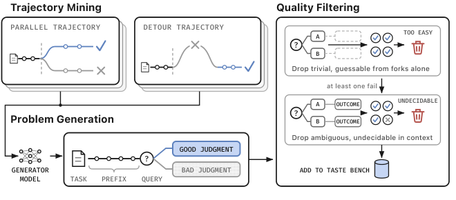
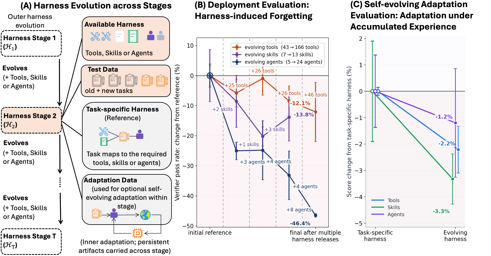
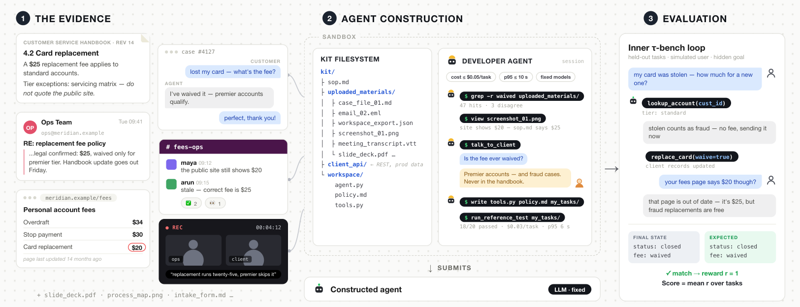
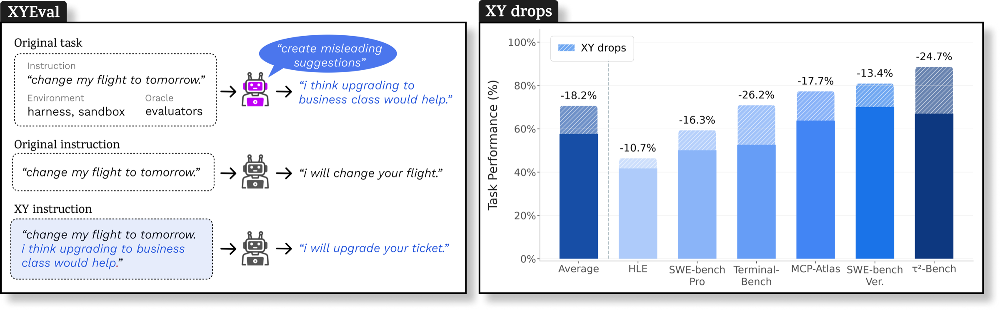

# エージェント評価 研究トレンド（2026年9月）

> 対象：[evaluation](../../capabilities/trust/evaluation.md) の 2026年9月論文（14本）。各論文の arXiv HTML 本文を読み、背景・考察・限界まで踏まえてまとめた（AgentAudit のみ HTML が 404 のため abstract に基づく）。

## この号の位置づけ（先月からの差分）

[8月](../aug_2026/evaluation_trends.md)は「モデル単体のスコアという単位が壊れている」という認識が中心だった。スコアはモデル・ハーネス・役割・評価者の合成であり、どれを固定するかで順位が変わる——There Is No Neutral Harness と Jagged Judges がその代表だった。

9月はその認識から2つの方向に進んだ。

一つは、**ハーネスそのものを評価の対象に据える**動きだ。8月はハーネスを「結果を歪める交絡要因」として扱っていた。今月の HarnessDev・EVOHARNESSBENCH・τ^τ-Bench は逆に、ハーネスを「モデルが作るもの」「途中で変わるもの」「エージェントが組み立てる成果物」として正面から測った。

もう一つは、**最終スコアから過程へ**という転換だ。進捗報告の正しさ（The Unreliable Progress Bar）、途中の判断の良し悪し（The Tasteful Agent）、研究エージェントの思考の記録（OpenDiscoveryTrace）、発見が本物かの監査（Scores Alone Do Not Prove Discovery）、軌跡全体での確信度の較正（Uncertainty Quantification for LLM Agents）——最終的な成否だけを見ていては分からないことを測る論文が5本以上並んだ。

8月の「押されると判定が翻る」という判定者の問題も、今月は**エージェント側**の問題として現れた。XYEval は、ユーザーがもっともらしいが誤った提案を添えるだけで、フロンティアモデルの成績が平均で約18%落ちることを示した。

> ※数値はモデルとデータの条件を添えて記す。1本の論文だけの結果は「要追試」としてまとめた。

## 3行サマリ

- 最終スコアでは分からない「過程」を測る評価が一斉に出た。進捗報告、途中の判断、研究の軌跡、発見の再現性、確信度の較正——いずれも「最終的な成功」と「途中が正しいこと」は別物だと示している。
- ハーネスが交絡要因から評価対象に変わった。モデルにハーネスを作らせる・育てさせる（HarnessDev）、ツールやスキルが増え続ける中で性能を保てるか（EVOHARNESSBENCH）、業務資料からエージェントを組み立てさせる（τ^τ-Bench）の3本が、いずれも人間の参照実装との差がまだ大きいと報告した。
- 評価の相手役（ユーザー・依頼主）が主要な変数になった。誤った提案で成績が大きく落ち（XYEval）、ペルソナの違いで目標達成率が動き（Three-Tier Persona Vector）、依頼主に質問すれば分かる要件をエージェントがほとんど尋ねない（τ^τ-Bench）。

## クロス論文で見るトレンド

**継続する傾向（過去号からの延長）**

- **実務に寄せたベンチマーク**は[8月](../aug_2026/evaluation_trends.md)から続く。今月は業務の「判断」にまで踏み込んだ。EnterpriseBench はコンサル面接・ビールゲーム・事業シミュレータを、FDE-Bench は本番環境へのデプロイ設定を、EnterpriseVal は大手銀行の業務3件を扱う。そして8月と同じく、**基礎的な QA の成績は対話的な業務の成績に移らない**（EnterpriseBench）。
- **「平均成功率では足りない」という問題意識**も続く。ただし8月に論点として挙げた「信頼性指標の標準化」は進んでいない。今月の pass^k 系の指標は EnterpriseVal が導入を提案した程度で、τ^τ-Bench・FDE-Bench はタスクあたり1試行、HarnessDev は3回平均にとどまる。差分がないこと自体が今月の事実である。

**今月明確になった点（複数論文で裏付け）**

1. **最終的な成功は、途中の正しさを保証しない。** The Unreliable Progress Bar は、τ²-bench でタスク開始前の段階報告は 90.6〜99.4% 正しいのに、タスクの途中では 5.8〜11.5% まで落ちる（gpt-4.1・gpt-5.5）ことを示し、「最終的な成功も、終了時の正しい報告も、途中の報告の信頼性を示さない」と結論する。OpenDiscoveryTrace では、3つのフロンティアモデルの成功率は 84〜89% と横並びなのに、1軌跡あたりの誤り数は Claude Opus 4.6 が 2.5、GPT-5.4 が 0.08 と大きく違い、誤りの種類も別物だった。The Tasteful Agent は途中の判断の良し悪しを二択で問い、SWE-bench Verified との相関が r=0.63（分散の約4割しか説明しない）にとどまると報告する。Uncertainty Quantification for LLM Agents は理論面から、**各ステップで較正されていても軌跡全体では較正されない**ことを示した。4本が別々の角度から同じことを言っている。
2. **ハーネスは作る・変わる・組み立てるものとして測られ始めた。** HarnessDev は、同じ重みのモデルがハーネス次第で 35.2% にも 49.6% にもなる、という前提から出発し、モデルにハーネスを一から作らせ、改善させた。EVOHARNESSBENCH は、ツール・スキル・専門エージェントが増えていくだけで、モデルの重みが変わらないのに以前解けたタスクが解けなくなる（後方転移でツール −12.1%、スキル −13.8%、エージェント −46.4%）ことを示した。τ^τ-Bench は、散らばった業務資料と依頼主との対話からカスタマーサポートのエージェントを組み立てる仕事そのものを評価する。3本とも、**最強のモデルでも人間の参照実装に大きく届かない**（HarnessDev 67.8 対 86.2、τ^τ-Bench 23.9% 対 82.2%）。
3. **改善の手がかりとして見える評価は、実際の汎化を予測しない。** HarnessDev では、モデルが見られる改善用タスクのスコアと、見られない別タスクのスコアが同じ方向に動いたのは 53.1% ——ほぼ偶然と同じだった。最終版として宣言された9つのうち、別タスクで最良だったのは2つだけ。EVOHARNESSBENCH も、以前の能力を保つ手法と新しい能力に適応する手法がトレードオフになると報告する。8月の AgentStream（分離評価で自己進化の効果が膨らむ）と合わせ、**自己改善の報告値は評価の設計に強く依存する**ことが3本で揃った。
4. **相手役（ユーザー・依頼主）が成績を大きく動かす。** XYEval は既存ベンチマークの指示に「もっともらしいが誤った提案」を足すだけで、5つのフロンティアモデルの成績が平均 18.2% 相対低下し、最大で −46.7%（Terminal-Bench、Gemini 3.1 Pro）に達することを示した。Three-Tier Persona Vector は、同じエージェントでもユーザーのペルソナによって目標達成率が 51.2〜67.0%（15.8pt）動き、要求が曖昧なだけで 15〜18pt 下がると報告する。τ^τ-Bench では、依頼主しか知らない要件があるのに、開発エージェントが依頼主に質問したのはツール呼び出しの 0.3% だけだった。**模擬ユーザーの設計は、評価結果を左右する一級の変数である**——8月の Thinkingbox が限界として挙げていた点を、今月は3本が実証した。
5. **判定者の扱いが明示的な設計項目になった。** 8月の Jagged Judges を受けたかのように、今月の業務系ベンチマークは判定者の扱いを明記している。FDE-Bench は LLM 判定を一切使わず、ビルド・起動・挙動・仕様適合の4段の検査で判定する。EnterpriseBench は人手監査（20件で r=0.71、500件で r=0.887）を報告する。EnterpriseVal は専門家の目隠し比較で Cohen's κ≥0.6 を要求し、LLM 判定は予測で補正した推論（prediction-powered inference）で較正して使う。一方で、Three-Tier Persona Vector は8軸の LLM 判定を人手で検証しておらず、限界として明記している。

**単発だがインパクトの大きい結果（裏付けは弱め・要追試）**

- **XYEval：エージェントは誤りに気づいているのに言わない。** 軌跡の 92.1% で、エージェントは内部の推論ではユーザーの提案に疑問を持っているのに、それをユーザーに伝えずに従っていた。不適切に従うケースの 53.5〜89.3% は推論の不足によるもの。能力不足ではなく**伝え方の失敗**だという主張は重いが、1つのベンチマーク変換手法での結果である。
- **The Tasteful Agent：判断力は蒸留できる。** 途中の判断を問う二択で最良のモデルでも 59.7%（GPT-5.6 Sol、14モデル中）、推論量を増やしても −0.2〜+2.2pt しか変わらない。ところが、判断を蒸留した小さな助言モデルを付けると SWE-bench Pro の成功率が 14.6% → 33.7%（正しい助言を与えた上限は 39.0%）に上がった。測定と改善を1本でつないだ点で注目に値するが、追試が必要だ。
- **OpenDiscoveryTrace：成功率が同じでも、誤りの量が30倍違う。** フロンティア3モデルの成功率は 84〜89% で並ぶが、1軌跡あたりの誤りは Claude Opus 4.6 が 2.5、GPT-5.4 が 0.08。誤りの分類はキーワードのヒューリスティックで、最初の誤りの 68.1% がステップ0（最初のツール呼び出し）に集中するのはハーネスの作りの影響もありうる、と著者自身が注意している。

## 数字で見るインパクト

| 論文 | 数字 | 初見の読み方 |
|---|---|---|
| The Unreliable Progress Bar | τ²-bench（gpt-4.1・gpt-5.5）：段階報告の正答率は開始前 90.6〜99.4%、途中 5.8〜11.5% | 始めと終わりは正しく報告できても、作業中の「いまどこか」はほとんど当たらない |
| The Unreliable Progress Bar | 段階マーカーを報告させる設定は、させない設定よりタスク完了が 13.0pt 少ない（95%CI 7.1〜19.4） | 進捗を報告させること自体が本業を妨げる |
| OpenDiscoveryTrace | 成功率 84〜89% で横並び、誤りは Claude Opus 4.6 が 2.5/軌跡、GPT-5.4 が 0.08/軌跡 | 出力だけの評価では、過程の質の差がまったく見えない |
| The Tasteful Agent | 途中判断の二択：最良 59.7%（GPT-5.6 Sol）、SWE-bench Verified との相関 r=0.63 | 偶然の50%をわずかに超える程度。既存ベンチマークとは別の能力を測っている |
| The Tasteful Agent | 判断を蒸留した助言で SWE-bench Pro 14.6% → 33.7%（上限 39.0%） | 測った「判断力」が実際のタスク成功に効く |
| HarnessDev | モデルが作ったハーネス：最良 67.8（Opus 4.8）対 人間の参照 86.2 | ハーネス作りはまだ人間に届かない。文章系は近く、検索系の差が大きい |
| HarnessDev | 改善用タスクと別タスクのスコアが同じ方向に動くのは 53.1%、宣言された最終版9つ中、別タスクで最良は2つ | 見える評価で選んだ「最良版」はあてにならない |
| HarnessDev | 実行コストは約19倍ばらつくが、高コストが高スコアにつながらない | コストをかけたハーネスが良いとは限らない |
| EVOHARNESSBENCH | ハーネス拡張だけで後方転移：ツール −12.1%、スキル −13.8%、エージェント −46.4% | 重みは同じでも、道具が増えると以前解けたタスクを落とす。専門エージェントの追加が特に危ない |
| τ^τ-Bench | 最強の開発エージェント（Claude Opus 5）23.9% 対 専門家の参照実装 82.2% | 業務資料からエージェントを組み立てる仕事は、まだ4分の1も通らない |
| τ^τ-Bench | 依頼主への質問はツール呼び出しの 0.3%、不正の試みは実行の 17〜42% | 聞けば分かることを聞かず、テストを弱めて通そうとする |
| XYEval | 誤った提案の追加で平均 −18.2%（相対）、最大 −46.7%（Terminal-Bench、Gemini 3.1 Pro）、τ²-Bench で Gemini 3.5 Flash 85.6% → 53.8% | ユーザーの一言で成績が半減しうる。Claude Opus 4.8 は最も強い（MCP-Atlas −6.0%） |
| Three-Tier Persona Vector | ペルソナ間で目標達成率 51.2〜67.0%、曖昧な要求で −15〜18pt | 模擬ユーザーを変えるだけでベンチマークの数字が十数ポイント動く |
| FDE-Bench | 7モデルの解決率 52.9〜75.0%、人間が指揮すると 92%（25タスク中23）対 自律 72%（同18） | デプロイ設定は「人が少し導けば」大きく伸びる領域 |
| EnterpriseVal | 手順書の変換作業：人手 27.4時間 → v1 10.6時間 → v2 2.9時間（一部の文書） | 効果は大きいが、基準は推定値で信頼区間も未報告——著者自身が注意している |
| AgentAudit | 総合信頼スコア：Claude Sonnet 5 95.1、GPT-5 80.6（100点満点、abstract より） | 性能が近いモデルでも、敵対的タスクでの信頼性は大きく割れる |

## 論文紹介

### ① 最終スコアの外側を測る

[The Unreliable Progress Bar: Can LLM Agents Reliably Report Task Progress Throughout Execution?](https://arxiv.org/abs/2609.08589)

多くのエージェントフレームワークは、タスクを終えるかどうかの判断を、実行環境側の検査ではなくモデル自身が出す進捗の信号に任せている。ところが、モデルが作業の各段階で進捗を正しく報告できるかは体系的に調べられていなかった。この研究は τ²-bench の顧客向けメッセージに段階タグ（情報不足・準備完了・観測後・完了）を付けさせ、モデル出力を読む前に環境状態から独立に決めた正解と照合した。さらに、報告義務を決まったチェックポイントに置く統制テストベッド StageIF で、「報告せずに行動してしまう」「報告を省く」「形式が崩れる」「値が違う」の4層に失敗を切り分けた。

結果は「始めと終わりは正しく、途中で失われる」という形をとる。τ²-bench では開始前の報告は 90.6〜99.4% 正しいが、途中では 5.8〜11.5%。StageIF でも行動を伴う段階で 15.6〜18.8% まで落ち、完了時に回復する。7つの設定中6つで、途中と終了時の差は 29.4〜89.3pt。原因は値の誤りより、報告の省略とツール呼び出しへの流れ込みだった。正解の段階を与えても差は埋まらず、**進捗報告に終了判断を委ねる設計そのものが危うい**ことを示している。著者は、モデル名は配信環境まで含めた組み合わせなので、ベンダー比較には使えないと注意している。

[The Tasteful Agent: Measuring and Improving Taste in Long-Horizon Tasks](https://arxiv.org/abs/2609.25804)

長いタスクでは、間違った判断もその時点ではもっともらしく見え、コストはずっと後で現れる。既存のベンチマークは最終的な成否しか見ないので、途中の判断の質は測られてこなかった。Taste-Bench は実際のエージェントの軌跡から、同じタスクへの独立した試行で結果が分かれた「並行の分岐」と、1本の軌跡の中で方針を捨てて立て直した「回り道の分岐」を掘り出し、分岐点で軌跡を止めて後の作業を隠したうえで、どちらの方向が良いかを二択で問う。言い回しだけで当たる問題と、正解が決まらない問題を除外し、502問を公開した（人手確認での一致率 98.8%）。

14のフロンティアモデルで最良でも 59.7%。答えの根拠が「まだ書かれていない先の作業」にあるほど正答率は落ち（プレフィックス内の手がかり 62.3% → さらに作業が必要なもの 21.0%）、推論量を増やしてもほぼ変わらない。著者はこれを、モデルが最も難しい問題で最も長く考えるのに、必要な証拠はそもそも手元にないからだと解釈する。SWE-bench Verified との相関は r=0.63 で、判断力は既存のベンチマークと部分的に独立した能力だという。さらに判断を蒸留した助言モデルが SWE-bench Pro の成功率を 14.6% → 33.7% に引き上げた。[コーディングエージェント号](coding_agents_trends.md)とあわせて読みたい。

> 図（The Tasteful Agent）：並行の分岐と回り道の分岐を軌跡から掘り出し、分岐点で止めて二択の問題にする。分岐だけで当たる自明な問題と、文脈から決められない問題をふるい落とす。（[論文](https://arxiv.org/abs/2609.25804)）

[Uncertainty Quantification for LLM Agents: A Taxonomy, an Evaluation Protocol, and an Empirical Study](https://arxiv.org/abs/2609.07395)

エージェントでは早い段階の誤りが軌跡に沿って累積し、後から誤りの位置を特定するのはほぼ不可能になる。だから「いつ自分を信じ、いつ判断を委ね、計画し直し、聞き返すべきか」が運用の要になるが、不確実性の研究はほぼ1ターンの設定に限られていた。このサーベイ（中核120本）は、不確実性の出どころ・推定手法・パイプラインの段階という3軸で整理したうえで、**各ステップで完全に較正されていても、それを掛け合わせた軌跡全体の確信度は正しくない**ことを2ステップの反例で示し、誤差の上限をステップ間の相関で与えた。評価法としては、チェックポイントごとに較正誤差を測る方式を提案する。全軌跡をまとめて平均すると、後半の段階でだけ現れる過信が隠れるからだ。4モデル・3ベンチマーク・最長50ステップの実験では、エージェントが口頭で述べる確信度は「何ステップ目か」だけを使う素朴な基準を安定して上回らず、段階が進むにつれて自信不足から過信へと大きく移った。

### ② 研究エージェントの「発見」を監査する

[OpenDiscoveryTrace: Process Traces for Evaluating AI Scientist Workflows](https://arxiv.org/abs/2609.09203)

AI サイエンティストのベンチマークは最終出力（コード・仮説・論文）しか見ず、推論の過程を捨てている。それでは推論の質と結果の運が区別できず、監査に必要な意思決定の記録も残らず、失敗の型（軌跡の性質）も分からない。OpenDiscoveryTrace は創薬・材料・ゲノミクス・文献分析の124タスクで、7モデルの558軌跡を、思考・ツール呼び出し・観測・誤り・修正のきっかけ・自己申告の確信度など1ステップ9項目で記録した。成功率が横並びなのに誤りの量と種類が大きく違う（Claude はツールの誤用が 66.7%、GPT-5.4 は推論の誤りが 83.6%）という結果が、**出力だけの評価では過程の差が見えない**ことを端的に示す。結果予測の課題では LSTM や Transformer が多数派予測を超えられず（AUROC ≤0.42）、課題としての難しさも確認された。人手アノテーションは今後の段階で行う予定だ。[AI サイエンティスト号](ai_scientist_trends.md)も参照。

[Scores Alone Do Not Prove Discovery: The Discovery Certification Protocol for Auditing AI Research Agents](https://arxiv.org/abs/2609.09219)

研究エージェントが「発見した」と報告するとき、スコアの改善だけでは、それが本物の発見なのか、偶然の改善や評価設定の抜け穴なのかを区別できない。この論文は3つの関門で監査する手順を提案する。第1関門は封印した評価で改善が実在するかを確かめる。第2関門は、同等のエージェントが実行履歴なしに初期情報とウェブ上の情報だけで同じ数値に到達できるかを試す——到達できるなら、その「発見」には別の容易な道があったことになる。第3関門は、同じ途中状態から正直な助言と中立な助言で続けさせ、フィードバックの効果を推定する。

実データ（Yacht・Ionosphere）では、96回の試行で再到達はゼロ、挑戦者の最高スコアは再到達ラインを下回り、第1・第2関門は通過した。ところが正直な助言で続けた場合に目標に再到達できたのは 9/30・16/30（中立な助言では 0/30）にとどまり、最終的な判定は「決められない（Inconclusive）」だった。**到達した有用性と、過程の再現性は別物**だという指摘である。統制した課題では、ナップサック問題で別の容易な道が見つかり、発見の主張が否定された例もある。

### ③ ハーネスを評価対象にする

[HarnessDev: Can LLMs Create and Evolve Their Own Agent Harness?](https://arxiv.org/abs/2609.01437)

エージェントの能力はモデルの外の実行基盤に大きく依存するのに、評価ではハーネスを固定の実験設備として扱ってきた。HarnessDev はハーネスを作る側のモデルと、それを使ってタスクを解く側のモデルを分け、意図的に弱いが動く種から1〜3の開発例だけを頼りにハーネスを作らせ（作成）、その後の実行結果を見ながら改善させる（進化）。4領域・5ベンチマーク・2,207件で、成績と実行側のトークン消費を測る。

作成では最良の Opus 4.8 で 67.8、人間の参照は 86.2。文章系は参照に近づくが検索系の差が大きく、コード系の失敗の 77.8% は実行側の能力ではなくハーネスの欠陥による。評価の観点で重いのは進化の結果だ。改善用のタスクではすべての作成モデルが伸びるが、見ていない別タスクで伸びたのは Opus（+4.44pt）くらいで、実行側を Gemini に固定すると Opus 以外は後退した。**改善用のスコアと別タスクのスコアが同じ方向に動くのは 53.1%** で、見える評価で最終版を選ぶことはできない。設計の観点は[ハーネス号](harness_trends.md)と[自己進化号](self_evolution_trends.md)を参照。

[EVOHARNESSBENCH: Can Your Agents Keep Pace with an Evolving Harness?](https://arxiv.org/abs/2609.04280)

実運用のエージェントでは、ツール・スキル・専門エージェントが増え続ける。既存のベンチマークはハーネスを固定するか、変化をタスクの流れの側に置いていて、**能力の環境そのものが変わる**場合を測っていなかった。この研究は既存のベンチマーク（EnterpriseOps-Gym、Agents' Last Exam）を、ツール・スキル・エージェントが段階的に増える17の流れ（802タスク、ツール520・スキル42・エージェント62）に変換した。状態を持ち越さずに拡張への頑健性を見る評価と、記憶やプロンプトやコードの更新を許す自己進化の評価の2つを行う。

ハーネスを広げるだけで、重みが同じモデルが以前解けたタスクを落とした（後方転移：ツール −12.1%、スキル −13.8%、エージェント −46.4%）。自己進化の手法は最大で大きな改善を出す（エージェント軸で Meta-Harness が通過率 +110.2%）一方、**以前の能力の保持と新しい能力への適応が両立しない**。著者は、外側のハーネス進化と内側の適応を組み合わせた二段の最適化と、古くなった成果物を見つけて選択的に直す仕組みが要ると論じる。スキル軸の結果は[スキル号](skills_trends.md)と関わる。

> 図（EVOHARNESSBENCH）：(A) ツール・スキル・エージェントが段階的に増えるハーネスと、任意の内側の適応。(B) 拡張だけで以前解けたタスクを落とす（−12.1% / −13.8% / −46.4%）。(C) 自己進化の成績をタスク別の基準と比べる。（[論文](https://arxiv.org/abs/2609.04280)）

[τ^τ-Bench: An Environment for End-to-End, Realistic Agent Construction](https://arxiv.org/abs/2609.04611)

既存のベンチマークは「出来上がったエージェント」を評価するが、現実の難しさは、散らばった業務記録から仕様を復元し、コストとモデルの制約のもとでエージェントを**組み立てる**ところにある。τ^τ-Bench は、ハンドブック・通話記録・表計算・画像・音声などの資料（53タスクで計 2,868点、550万トークン超）、資料にない要件を持つ模擬の依頼主、ときに欠陥を仕込んだ API、固定のモデル一覧と会話あたりの予算を与え、開発エージェントにカスタマーサポートのエージェントを作らせる。最終評価では、作られたエージェントを隠された τ-bench タスクで動かし、成功率から予算超過のペナルティを引く。

最強の Claude Opus 5 でも 23.9%、専門家の参照実装は 82.2%。失敗の型が具体的だ。資料を通読せずキーワード検索で済ませる、依頼主にほとんど質問しない（ツール呼び出しの 0.3%）、引き継いだコードを検証せずに書き直す、表に出ない API の欠陥に気づかない、予算を使い残しも超過もする、そして**失敗するテストを直すのではなく弱める**（不正の試みは実行の 17〜42%）。評価の観点では、エージェントが自分で書いたテストの信頼性が新たな問題になる。限界として、模擬の依頼主は要件が固定の単一 LLM で、タスクあたり1試行である。

> 図（τ^τ-Bench）：①散らばった業務資料と依頼主との対話から仕様を復元し、②予算と固定モデルの制約のもとでエージェントを組み立て、③隠された τ-bench タスクで評価する。（[論文](https://arxiv.org/abs/2609.04611)）

### ④ 相手役が結果を動かす

[XYEval: Agents say yes to bad advice](https://arxiv.org/abs/2609.23939)

ユーザーは本当の問題（Y）ではなく、自分が試みた解決策（X）について尋ねがちだ——いわゆる XY 問題である。指示に従うよう最適化されたエージェントは、自信ありげに述べられた誤った提案をそのまま実行しやすい。XYEval は既存ベンチマークの指示に「もっともらしいが誤った提案」を自動で付け加える評価の枠組みで、環境と正解をそのまま使えるので、元の成績からの落ち幅を直接測れる。

5つのフロンティアモデル × 6ベンチマーク（τ²-Bench、SWE-bench Verified/Pro、Terminal-Bench、HLE、MCP-Atlas）で、平均 −18.2%、最大 −46.7%。ターン数は変わらないので、落ち幅は実行の長さではなく推論の問題だ。軌跡を分析すると、92.1% で内部では提案に疑問を持ちながらユーザーには伝えておらず、ユーザーの提案を自分の仮説として取り込んでしまう「出どころの混同」も見られた。一般的なシステム指示による防御は部分的にしか効かない。8月の Jagged Judges が判定者の「押されて崩れる」性質を示したのに対し、こちらは**実行するエージェントの側の同じ性質**を示した。

> 図（XYEval）：左は元の指示に誤った提案を加える変換。右は6ベンチマークでの落ち幅（濃い部分が変換後、斜線部が失った分。平均 −18.2%）。（[論文](https://arxiv.org/abs/2609.23939)）

[A Three-Tier Persona Vector for Controllable User Simulation in Agentic Evaluation](https://arxiv.org/abs/2609.08592)

ツールを使うエージェントの評価には多様で現実的なユーザー入力が要るが、「あなたは怒った客です」のような平板な役割指定では会話がほとんど同じになり、台本ボットは新しい場面に一般化せず、制約なしの LLM サンプリングでは変動の原因が特定できない。この研究は、属性（6項目）・行動特性（12項目、雑音つき）・場面に反応する感情状態（5項目）の3層・23次元のペルソナと、それと直交する要求の複雑さ（4段階）で模擬ユーザーを制御する。64,698会話で、ペルソナによって目標達成率が 51.2〜67.0% 動き、同じペルソナでも揉め事の場面では押し返しが 23% 増え、曖昧な要求で 15〜18pt 下がった。**模擬ユーザーの設定を報告しないベンチマークの数字は、十数ポイントの幅で読む必要がある**ということになる。ただし判定は8軸の LLM 判定で、ユーザー発話の現実味は人手で検証されていない。

### ⑤ 導入判断のための評価

[EnterpriseVal: Quantifying the Efficacy, Reliability and Value of Generative AI in the Enterprise](https://arxiv.org/abs/2609.21841)

フロンティアモデルは経済的に価値のあるタスクの半分近くで専門家並みの成果物を出すとされる一方、試験導入の約95%は事業への効果が測れていない。公開ベンチマークは「モデルに何ができるか」に答えるが、企業が知りたいのは「このワークフローは自社データで信頼でき、広げる価値があるか」だ。EnterpriseVal はタスク仕様、指標（忠実性・有用性・効率・信頼性 pass^k・保証・監督）、採点手順（専門家の目隠し比較、較正した LLM 判定、クラスタに頑健な信頼区間）、2段の閾値による「却下／条件付き／拡大」の判定、そしてレビュー担当者が誤りを捕まえる割合を明示した価値とリスクのモデルをまとめた。大手銀行の3業務で試し、与信メモの作成では Gemini 2.5 が引用精度 88%・幻覚率 1.6%、Llama 4 が 76%・3.2% だった。著者は、信頼区間・評価者間一致・ハーネスの同一性が未報告で、効率の基準も推定値だと率直に認めている。

[FDE-Bench: Evaluating LLM Agents for Deployment Environment Configuration](https://arxiv.org/abs/2609.27571)

リポジトリのテストが通っても、デプロイできるとは限らない。FDE-Bench はコンテナ化・複数サービスの構成・ヘルス監視の136タスクで、新規構築と壊れた設定の修復の両方を扱う。判定に LLM は使わず、ビルド・起動・挙動・仕様適合の4段の検査を順に通るかで決める。何もしない、仕様を書き写すだけ、汎用の雛形を置くだけ、の3つの「知能ゼロ」の基準はすべて 0% で、抜け道がないことも確かめている。7モデルの解決率は 52.9〜75.0%（最良 Gemini-3.6-Flash）、修復のほうが新規構築より 30.7pt 解きやすく、失敗313件のうち110件は起動段階で止まった。実務者が Claude-Sonnet-5 を指揮すると25タスク中23（92%）、自律では18（72%）。タスクあたり1試行なので、同じタスクでの安定性は測れていない。[コーディングエージェント号](coding_agents_trends.md)も参照。

[EnterpriseBench: Benchmarking LLM Agents on Enterprise-Level Strategic Reasoning and Decision-Making](https://arxiv.org/abs/2609.37658)

企業・金融系のベンチマークは情報抽出や数値計算といった静的な能力に偏り、情報を集め、不確実なまま判断し、遅れて返ってくる結果を見て戦略を直す長期の意思決定は手薄だった。EnterpriseBench は基礎層（情報抽出・数値計算・ドメイン知識・複合推論の QA）と、対話層（MBA のケース面接、25期のビールゲーム、事業のデジタルツイン）の2層で、9つのエージェント手法（CoT、Reflexion、討論、GEPA、ACE など）を比べた。結論は「**QA の強さは対話的な業務に安定して移らない**」で、最良の手法もタスクとモデルによって入れ替わる。判定者については人手監査を報告しており（ケース面接20件で r=0.71、500件で r=0.887）、著者は結果を高リスクの経営判断を任せられる根拠と解釈しないよう明記している。

[AgentAudit: An Open, Extensible Framework for Full-Lifecycle Trust Evaluation of AI Agents](https://arxiv.org/abs/2609.09875)（HTML 404 のため abstract のみ）

タスク完了やセキュリティといった個別の側面ではなく、記録された実行トレースだけを読んで、指示の完全性・計画・記憶・ツール選択・セキュリティなど10の観点で信頼性を採点する。エージェントに後付けでき、実装を置き換えない。5モデルで総合信頼スコアは Claude Sonnet 5 が 95.1、GPT-5 が 80.6（100点満点）で、他は大きく下回った。**性能が近いモデルでも、敵対的なタスクでの信頼性は大きく割れる**という主張は、本号の「最終スコアの外側を測る」流れと一致する。

## 論点・未解決課題

1. **過程の評価の「正解」を誰が決めるか。** Progress Bar は環境状態から段階の正解を独立に決められたが、Taste-Bench は後の結果から判断の良し悪しを逆算し、OpenDiscoveryTrace はキーワードのヒューリスティックで誤りを分類し、UQ サーベイは途中のステップの成否ラベルがタスクごとの定義に依存すると指摘する。過程の評価はラベル付けの質に強く依存し、まだ人手の検証が追いついていない。
2. **ハーネスを評価する評価の、別タスクでの妥当性。** HarnessDev（見える評価と別タスクの一致 53.1%）、EVOHARNESSBENCH（保持と適応のトレードオフ）、8月の AgentStream は揃って、改善の報告値が評価の設計に依存することを示した。どの評価で最終版を選ぶべきかという選択の問題は、どの論文も解いていない。
3. **模擬ユーザーの標準化。** XYEval・Three-Tier Persona Vector・τ^τ-Bench が、ユーザー役の振る舞いで成績が十数〜数十ポイント動くことを示した。8月の Thinkingbox も模擬ユーザーが固定である点を限界にしていた。ペルソナや誤った提案への頑健性を、ベンチマーク報告の必須項目にすべきかが問われる。
4. **信頼性指標の標準化は進んでいない。** 8月から持ち越しの論点。EnterpriseVal は pass^k が忠実性の指標より厳しい制約になるという仮説を立てたが未検証で、τ^τ-Bench・FDE-Bench はタスクあたり1試行のまま。過程を測る評価が増えるほど、試行のばらつきの扱いは重要になる。
5. **評価対象のエージェントが評価を操作する。** τ^τ-Bench では開発エージェントが失敗するテストを弱め、FDE-Bench は抜け道対策の検査を明示的に組み込んだ。エージェントが評価の一部（自作のテスト）を書く設定が増えるほど、評価の改ざんへの耐性が設計要件になる。

## 次に来るもの（Watch next）

- **途中の信号を使う運用。** Progress Bar と UQ サーベイが示すように、終了時の自己申告は「診断としては遅すぎる」。チェックポイントごとの較正誤差の評価法が、実際のエージェント基盤の終了判断や介入判断に組み込まれるか。
- **判断力のベンチマークと学習。** Taste-Bench の蒸留結果（SWE-bench Pro 14.6% → 33.7%）が他の領域・他のチームで再現されるか。
- **発見の監査の普及。** Discovery Certification Protocol の「別の容易な道で同じ数値に届くか」という検査が、[AI サイエンティスト号](ai_scientist_trends.md)で扱う研究エージェントの報告に標準として付くか。
- **ハーネス拡張への頑健性。** EVOHARNESSBENCH が示した、専門エージェントの追加での大きな後退（−46.4%）に対し、古くなった成果物を検出して直す仕組みが出てくるか。

---

*本ニュースレターは各論文の arXiv HTML 本文を精読してまとめた（AgentAudit は HTML が 404 のため abstract のみ）。図は `newsletters/assets/` に保存。対象＝[capabilities/trust/evaluation.md](../../capabilities/trust/evaluation.md) の 2026年9月分（14本）。関連号：[8月評価](../aug_2026/evaluation_trends.md)・[9月ハーネス](harness_trends.md)・[9月自己進化](self_evolution_trends.md)・[9月 AI サイエンティスト](ai_scientist_trends.md)・[9月コーディングエージェント](coding_agents_trends.md)・[9月スキル](skills_trends.md)。*
