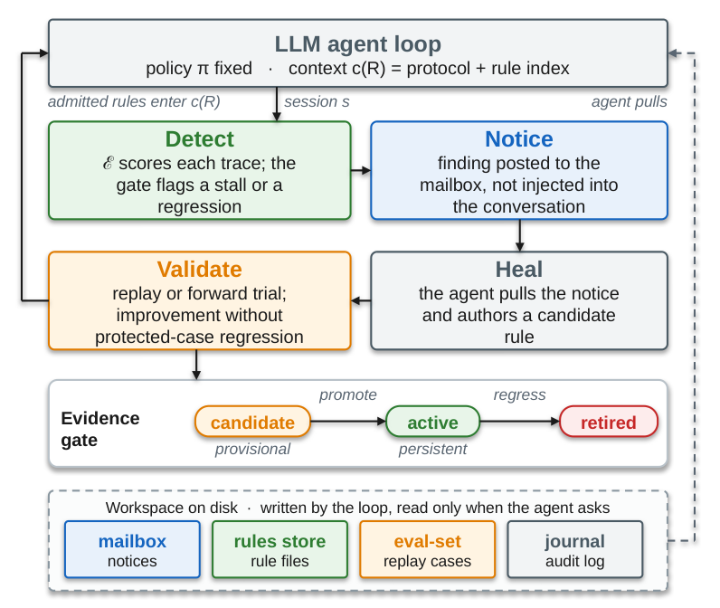
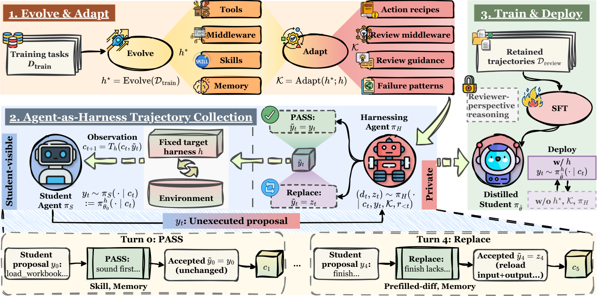

# ハーネス（Agent Harness）研究トレンド（2026年9月）

> 対象：[harness](../../architecture/harness.md) の 2026年9月論文（19本）。19本すべて arXiv HTML 本文を読み、背景・考察・限界まで踏まえてまとめた（abstract のみの論文はなし）。

## この号の位置づけ（先月からの差分）

[8月号](../aug_2026/harness_trends.md)の主題は、7月の「ハーネスの自動改善は進化に使った問題に過学習しているだけでは」という批判への応答だった。HarnessCompass や DarwinX は、学習に使っていないタスクでの検証を採用条件そのものに埋め込むことで答えた。

9月もこの路線は続いている。ハーネスの再帰的な自己改善を扱う論文だけで RRSI・ModularRSI・RobustSGPO・Self-Healing Harness と4本ある。ただし今月は、関心が「何を検証してから採用するか」から一歩進んで、**そもそも何をどこまで変えてよいか**——変更の量、変更してよい部品、変更の種類——を先に縛る設計に移った。同時に、HarnessDev が「フィードバック用の問題での伸びは、学習に使っていない問題ではかなり縮む」ことをモデル横断で測り、8月の楽観に条件をつけた。

今月の新しい動きは2つある。

第一に、**「強いモデルにハーネスはどこまで要るのか」を正面から問う論文**が複数出た。自律 ML エンジニアリングで、精巧なマルチエージェント構成が単一の長時間コーディングセッションに勝てないという結果（How Much of a Harness…）と、コーディングエージェントのハーネス部品を1つずつ外して測る実験（An Empirical Study of Harness Design）が、そろって「部品の価値はモデルの強さで反転する」と報告した。

第二に、**ハーネスの効果をモデルの重みへ移す、あるいはハーネスを書く能力そのものを訓練する**路線が太くなった。8月の JIT-Agent に続き、Harness-Zero は進化させたハーネスの振る舞いを 9B モデルに蒸留し、Harness Learning は 4B の「ハーネス修正役」を RL で訓練した。

> ※数値はモデルとデータの条件を添えて記す。1本の論文だけの結果は「要追試」として分けた。

## 3行サマリ

- ハーネスの部品の価値はモデルの強さで決まる。弱いモデルには計画・専用ツール・強い状態管理が効くが、強いモデルでは同じ部品がコストを増やすだけになりやすい（An Empirical Study of Harness Design・How Much of a Harness…・How Strongly Should Task State…・Subagents vs Agent Skills）。
- ハーネスの自己改善は、採用時の検証に加えて「変更の量・範囲・種類を先に縛る」方向に進んだ（RRSI・ModularRSI・RobustSGPO）。一方で、フィードバック用の問題での伸びは学習に使っていない問題では大きく縮み、改善の多くは他の挙動を壊していた（HarnessDev・Self-Healing Harness）。
- ハーネスを探索する対象から、学習するものへ——重みへの蒸留（Harness-Zero）、ハーネス修正役の RL 訓練（Harness Learning）、ハーネスを組む側のメタスキル学習（Meta-Skills）、繰り返す制御のコード化（Grow the Harness）が並んだ。

## クロス論文で見るトレンド

**継続する傾向（過去号からの延長）**

- **モデルを固定してハーネスだけを改善する路線**は今月も中心にある。RRSI・ModularRSI・RobustSGPO・Self-Healing Harness・Grow the Harness・Meta-Skills と6本が、ベースのモデルの重みを凍結したまま外側の仕組みだけを変える。[7月](../jul_2026/harness_trends.md)・[8月](../aug_2026/harness_trends.md)からの継続で、自己改善の観点は[9月 自己進化号](self_evolution_trends.md)でも扱う。
- **長期タスクでは「検証済みの状態を実行の外に持つ」**という8月の処方が、別の題材で再確認された。Harness-of-Harness（HoH）は実装の状態とは別に「過去のループで検証済みの知識」の状態を持ち、Thinking Before Thinking は全履歴を再生する代わりに簡潔なテキスト状態と成果物グラフを持ち回る。RankEvolve は手順書を状態機械にコンパイルして実行を縛る。
- **ハーネスを「ベンチマークで測る対象」にする流れ**も続く。8月の EVO-BENCH・HarnessOpt-Bench に続き、今月は HarnessDev（ハーネスを作り、育てられるか）と EvoHarnessBench（ハーネスが育つ側にエージェントが追いつけるか）が出た。測定面の詳細は[9月 評価号](evaluation_trends.md)へ。

**今月明確になった点（複数論文で裏付け）**

1. **部品の価値はモデルの強さで反転する。** An Empirical Study of Harness Design は Nemotron-3（30B/120B/550B）と Mistral で、計画の注入が 30B には SWE-bench Verified で +11.6pt 効く一方、550B では精度をわずかに落として費用を約3割削るだけ、専用ツールは 30B に効くが 550B では bash だけのほうが精度も費用も良い、と示した。How Much of a Harness… は MLE-bench で、フロンティア級のモデルなら単一セッションの最小構成（Malena）が公開済みの4つのハーネスすべてに並ぶか上回ると報告した。How Strongly Should Task State… では、思考を有効にすると「見せる・指示する・強制する」の差が縮む。Subagents vs Agent Skills も、サブエージェント化の利点はモデルとスキルの書き方に依存すると結論している。4本とも「どのハーネスが良いか」ではなく「**どのモデルに、どの部品が要るか**」という条件つきの問いに置き換えている。
2. **自己改善では「何を変えてよいか」を先に縛るのが効く。** RRSI は1ラウンドあたりの変更数を徐々に絞り、効果に見合わない複雑化を拒み、効かない部品を刈り込む。ModularRSI はハーネスを5つの部品に分け、部品ごとに範囲を限って進化させる——ハーネス全体を一度に進化させると Terminal-Bench 2.0 で 47.57% の出発点より下の 46.44% に落ちた。RobustSGPO は生成前に変更の範囲・操作・対象を選び、指定どおりに変更されたかを照合する。3本が別々に「探索の自由度を上げても良くならない、帰属があいまいになるだけ」という診断に達した。
3. **フィードバックで測った改善は、そのままでは信用できない。** HarnessDev では、6つのモデルがハーネスを自分で育てたとき、フィードバック用の問題では +5.9〜+13.9pt 伸びたのに、学習に使っていない問題では +1.43〜+4.44pt に縮み、両者が同じ方向に動いたのは 53.1% だけだった。Self-Healing Harness では、再生検証で却下された 383 件の改善案のうち 211 件（55%）が、きっかけになった失敗は直していたが、それまで成功していた挙動を壊していた。RRSI も冒頭で、進化に使った分割では大きく伸びた改善が分布外のベンチマークで消えることを示している。
4. **ハーネスを「学習するもの」として扱う論文が4本並んだ。** Harness-Zero（進化させたハーネスの振る舞いを SFT で重みに移す）、Harness Learning（ハーネスを書き換える提案役を RL で訓練）、Meta-Skills（ハーネスを組む Builder 側が再利用できる原則を貯める）、Grow the Harness（繰り返し現れる制御を実行可能なコードとして育てる）。どれも「タスクごとにハーネスを探し直すコスト」を問題にしており、8月の JIT-Agent の延長線上にある。

**単発だがインパクトの大きい結果（裏付けは弱め・要追試）**

- **Harness-Zero**：Qwen3.5-9B に蒸留した結果、3ベンチマーク平均で、進化させたハーネスを付けた元モデル（41.7%）を上回る 44.3% になった。ハーネスの効果が重みに移るだけでなく、それを超えうるという主張。ただし USPTO 逆合成では蒸留後（30.0%）がハーネス付き（38.0%）を下回っており、深いドメイン知識は移りきらないと著者も認めている。1事例・要追試。
- **AgentZip**（Memory Compression for High-Fanout Agent Sandboxes）：並列ロールアウトでサンドボックスのメモリを 88.55% 削減（zswap は 48.66%）。ハーネスの実行基盤側の論文は少ないが、RL の大量並列ロールアウトで「計算より先にメモリが尽きる」という指摘は重要。1システム・R2E-Gym の10リポジトリでの評価。
- **EvoHarnessBench**：ツール・スキル・エージェントを足していくだけで、以前は解けたタスクが解けなくなる（エージェント軸の Agents' Last Exam で最大 34.7% の後退）。ハーネスの拡張そのものが忘却を起こす、という新しい問題設定。

## 数字で見るインパクト

| 論文 | 数字 | 初見の読み方 |
|---|---|---|
| An Empirical Study of Harness Design | SWE-bench Verified でコンテキスト管理の有無の差が 32k で 35.7pt、128k で 2.7pt | コンテキスト管理は窓が狭いときに効く部品。窓が広いとほぼ不要になる |
| 同上 | Nemotron-3 550B：bash だけで精度 +3.6%、費用 −53%（専用ツール比） | 強いモデルには専用ツールがむしろ足かせ。30B では逆に専用ツールが +15% |
| How Much of a Harness… | 探索戦略の差（best-of-N 対 UCB1）2.71 パーセンタイル点、95%CI −1.44〜+6.60（MLE-bench） | 精巧な探索構造の効果は誤差の範囲。効いているのはコーディングエージェント環境のほう |
| How Strongly Should Task State… | Qwen3-235B・10ステップ・思考なし：全履歴 0.38 → チェックリスト 0.55 → 指示 0.84 → 強制 0.98 | 状態をテキストで見せるだけでは足りず、行動を拒否する強制まで行くとほぼ完璧。ただし思考ありでは差が縮む |
| ModularRSI | Terminal-Bench 2.0・DeepSeek-V4-Flash で 47.57 → 52.43%（ハーネス全体を進化させると 46.44%） | 部品ごとに範囲を絞ると伸び、全体を一度にいじると出発点より悪化する |
| RRSI | Terminal-Bench 2.1 で進化 +6.0pt、未使用の SWE-bench で +1.8pt（Claude Opus 4.8 固定） | 分布外でも伸びは残るが、進化に使った側の3分の1程度。トークンは 30% 減 |
| RobustSGPO | 学習に使っていないタスクの完了率 60.0 → 80.0%（30タスク中24） | 変更の範囲と種類を先に選ばせるだけで探索の質が上がる。ただし1種類のワークフローのみ |
| HarnessDev | フィードバック用の問題で +5.9〜+13.9pt、未使用の問題で +1.43〜+4.44pt、同方向は 53.1% | 自己改善の伸びの大半は見えている問題への適応。方向が一致するのはほぼコイン投げ並み |
| 同上 | ハーネス作成：Opus 4.8 が 67.8、人間の参照実装は 86.2 | 文章作成では人手に並ぶが、コードと検索ではまだ大差 |
| Self-Healing Harness | 却下された改善案の 55%（383件中211件）が、狙った失敗は直しつつ既存の成功を壊していた | 「その失敗が直ったか」だけで採用すると、半数以上が退行を持ち込む |
| Harness-Zero | Qwen3.5-9B：最小ハーネス 23.3% → 進化ハーネス 41.7% → 蒸留後 44.3%（3ベンチマーク平均） | ハーネスなしで、ハーネス付きの元モデルを上回る。ただし USPTO では蒸留後のほうが低い |
| Harness Learning | Reasoning Gym の未使用21系統で 0.32 → 0.62、4B の提案役が 35B の教師（0.56）を上回る | ハーネスを書き換える技能は小さなモデルに学習でき、未知のタスク系統へ移る |
| Grow the Harness | LLM 呼び出し 76.0〜91.8% 減、展開時の費用 74.4〜98.6% 減（BrowseComp-Plus・WebArena-Verified） | 繰り返す制御をコードに移せば、モデル呼び出しは意味的な判断だけで済む |
| Meta-Skills | 6設定のマクロ平均 65.31%、スキルなしの Builder 比 +8.95pt、スキルを直接 Target に渡す方式比 +12.02pt | 原則は「読ませる」より「ハーネスとして実装する」ほうが効く |
| Harness-of-Harness | FrontierSWE の優位率 44%（素の実行）→ 71%（3ループ） | 同じ予算で素の実行を繰り返すより、計画・実装・検証のループに組むほうが良い |
| Thinking Before Thinking | ProgramBench・GPT-5.5：メタ推論 71.5% 対 直接制御 63.7% 対 Codex 58.0% | 12の比較すべてでメタ推論が上。ただし予算が小さいと逆転する |
| AgentZip | 並列ロールアウトでメモリ 88.55% 削減、実行時間は 1.40 倍（先読みなしだと 3.1 倍） | メモリを9割近く削っても、先読みがあれば遅延は zswap 並み |

## 論文紹介（サブテーマ別）

### ① 強いモデルにハーネスはどこまで要るか

[An Empirical Study of Harness Design for Coding Agents](https://arxiv.org/abs/2609.20804)

「ハーネスを変えれば同じモデルの性能が大きく変わる」ことは知られているが、先行研究はシステム全体を比べるので、どの部品が効いているのかが分からない。この研究は計画・行動空間・コンテキスト管理の3部品だけを動かし、他はすべて固定した。モデルは Nemotron-3 の3サイズと Mistral-Medium-3.5、コンテキスト予算は 32k〜128k の4段階、ベンチマークは SWE-bench Verified と Terminal-Bench 2.1 で、計176設定になる。

結論は「ハーネス設計は条件つきのシステム問題だ」というものだ。コンテキスト管理の効果は窓の広さで決まり、SWE-bench では管理あり・なしの差が 32k で 35.7pt あったのが 128k では 2.7pt に縮む。外部の記録を呼び戻す仕組みは、そもそもモデルがほとんど使わない（中央値はほぼ0回）。計画は弱いモデルには序盤の編集を支える足場になるが、強いモデルでは編集後の確認を短くして費用を削る程度にしか働かない。限界として、計画と行動空間の切り替えは 128k・最も強い管理方式でしか試していないこと、Terminal-Bench は89タスクで検出力が低いことを著者自身が挙げている。コーディングエージェント全体の文脈は[9月 コーディング号](coding_agents_trends.md)を参照。

> 図（An Empirical Study of Harness Design）：コンテキスト管理（5方式）・計画・行動空間を、4モデル×2ベンチマーク×4窓幅の176設定で切り分けた。窓が広いほど管理の効果は減り、計画と bash のみの行動空間は弱いモデルと強いモデルで効き方が逆になる。（[論文](https://arxiv.org/abs/2609.20804)）

[How Much of a Harness Does a Strong Agent Need for Autonomous ML Engineering?](https://arxiv.org/abs/2609.40303)

自律 ML エンジニアリングの分野には、マルチエージェントの指揮系統や専用サブエージェント、木探索といった仕組みが積み上がってきた。著者は、コーディング向けの事後学習を受けたモデルが実行環境を直接扱えるようになった今、それらがまだ必要なのかを問う。実行環境・探索戦略・自律度・マルチエージェント連携の4系統を、時間予算・ハードウェア・ベースのモデルをそろえて1つずつ外した。

最も大きく効いたのは「チャットではなくコーディングエージェント環境で動かすこと」で、探索戦略の差は誤差の範囲（best-of-N と UCB1 の差 2.71 パーセンタイル点、信頼区間は0をまたぐ）、マルチエージェント化にも有意な利点はなかった。単一の長時間セッションに提出管理とバックグラウンドジョブ管理だけを足した最小構成 Malena は、フロンティア級のベースのモデルでは MLEvolve・AiScientist・Arbor・ScienceFlow の4つすべてに並ぶか上回った。ただし主な根拠は既知の不備がある MLE-bench で、Malena と比較対象とで調整の手間が対称でない可能性も著者は認めている。AI 研究自動化の文脈は[9月 AI Scientist 号](ai_scientist_trends.md)へ。

[How Strongly Should Task State Influence an LLM Agent?](https://arxiv.org/abs/2609.25686)

タスクの状態（どの手順が済んだか、取り消されたか、やり直してよいか）をエージェントにどう効かせるか。プロンプトに書いて見せる方式と、別モジュールで強制する方式のどちらにどれだけ信頼性があるのか、体系的な測定はなかった。この研究は規則・モデル・エピソードを固定して、状態の結びつきの強さだけを「全履歴のみ → チェックリスト表示 → 毎ターンの指示 → 違反行動の拒否」の4段階で変えた。Qwen3-235B・10ステップ・思考なしでは 0.38→0.55→0.84→0.98 と段階ごとに上がる。ただし思考を有効にすると差が縮み、判断の要る PM-Bench では強制よりも記録を見せるほうが良かった。強制は「失敗が状態から機械的に判定でき、しかも頻繁なとき」に元が取れ、判定を誤れば自信を持って間違った指示を出す、というのが著者の整理だ。合成エピソード中心で、閉じたモデルのセルは n=32 と小さい。

[Subagents vs Agent Skills](https://arxiv.org/abs/2609.09233) と [Harness as a Language（JAZ）](https://arxiv.org/abs/2609.26891) は、同じ問いを「何を部品として作り込むか」の側から扱う。前者は SkillsBench の64タスクで、スキルを主エージェントのコンテキストに読み込む方式と、スキルごとに新しいコンテキストのサブエージェントを起動する方式を比べ、サブエージェントが勝つのは**入出力の約束を明示した手続き型のスキル**のときだけ、既存の手作りスキルではむしろ読み込み方式が良い、と示した（強いモデルでは8割超のタスクで最大コンテキスト長が下がるが、総トークンは増える。スキル設計の観点は[9月 スキル号](skills_trends.md)へ）。後者は、実装をその都度 LLM が書く関数 `invoke` だけを持つ最小ループで、長期記憶と継続的な自己改善を専用部品なしに実現できるかを試した。StuLife（GPT-5.4 nano）で、50タスク以上前の情報を要する問題の合格率が 69.9%、専用の記憶システム Letta の 61.8% を上回り、費用は半分以下だった。

### ② 自己改善は「何を変えてよいか」を先に縛る

[RRSI: Regularized Recursive Self-Improvement of Agent Harnesses](https://arxiv.org/abs/2609.24972)

ハーネスの再帰的な改善が分布外で効かなくなる原因を、ベンチマーク固有の当てはめ・評価のばらつきの追いかけ・複雑さの蓄積、の3つに分けた。対策は回帰の正則化になぞらえて設計されている。提案側では1ラウンドの変更数に徐々に厳しくなる上限をかけ、すでに反証された仮説を記録して再試行を避ける。採用側では、タスク固有のロジックを評価前に弾き、ばらつきを見込んだ下限を超えた候補だけを採用し、増えた複雑さが伸びに見合わなければ拒否し、効かない部品を刈り込む。Claude Opus 4.8 を固定した8ベンチマークで、Terminal-Bench 2.1 で進化させて +6.0pt、未使用の SWE-bench Verified で +1.8pt。Gemini 3.5 Flash で育てたハーネスを Gemini 3.1 Flash Lite に移すと +3.4pt。トークンは試行あたり 2.42M と、正則化しない場合の 3.8M より約3割少ない。限界として、ばらつきの許容幅を決めるのにベースラインの反復評価が要ること、より長い自己改善過程での検証が必要なことを挙げている。

[ModularRSI](https://arxiv.org/abs/2609.14857)

同じ問題に、部品分割と、ベンチマークと重ならない進化用データで答える。ハーネスを実行ループ・ツール使用・観測管理・コンテキスト管理・完了判定の5部品に分け、同じタスクの成功軌跡と失敗軌跡を対比して欠陥を見つけ、部品ごとに範囲を限って進化させてから統合する。進化には GitHub・Hugging Face・Kaggle から集めたベンチマークと重ならない2,000件を用意した（計算の都合で使ったのは240件）。DeepSeek-V4-Flash で Terminal-Bench 2.0 が 47.57→52.43%、SWE-bench Verified が 73.40→76.40%、Meta-Harness（49.44%）と AHE（49.81%）を上回った。効いているのは検証の関門で、外すと 48.31% まで落ちる。ハーネス全体を一度に進化させると 46.44% と出発点を割り込み、「変更範囲を絞ると帰属のあいまいさが減る」という仮説を裏付けている。

[RobustSGPO](https://arxiv.org/abs/2609.09646) はマルチエージェントのワークフローを対象に、生成する前に変更の範囲・操作・対象を選ばせ、構造の変更は事前定義のコードで行い、指定どおりに変更されたかを照合する。許可を広げても実際に生成される変更は偏る、という観察が出発点だ。学習に使っていないタスクの完了率が 60.0→80.0%、構造的に有効な変更の割合は 48.9→77.8% になった。ただし評価は1種類のブレインストーミング型ワークフローに限られ、トークン予算をそろえると単純な構造化探索との差は 0.10→0.04 に縮む。

### ③ 改善の検証は「直ったか」ではなく「壊していないか」

[Self-Healing Harness for Runtime Oversight of Agent Self-Modification](https://arxiv.org/abs/2609.24130)

長く動くエージェントは、記憶や運用ルールを書き換えて自分の将来の振る舞いを変えていく。どの変更を残すべきか。著者の出発点は「きっかけになった失敗が直ったことは、採用の十分条件ではない」というものだ。検出・通知・修復・検証のループで、エージェントは候補のルールをテキストで書くだけで、残すかどうかは外部の実行環境が決める。条件は、狙った失敗が改善し、**かつ**保護された過去の成功例で退行しないこと。

4モデル×3ベンチマークの16組すべてで完了スコアが上がったが、信頼区間が0を外れたのは2組だけと、効果自体は控えめだ。むしろ重要なのは副産物で、却下された 383 件の改善案のうち 211 件（55%）が「狙った失敗は直すが既存の成功を壊す」ものだった。著者は限界も率直に書いている。候補を1件ずつ審査しても、ルールが積み上がることによる劣化は防げない（AppWorld・gpt-luna ではルールが13から70に増えるにつれて単調に悪化した）。費用は全体で 1.72 倍。自己改善の安全性の観点は[9月 自己進化号](self_evolution_trends.md)と重なる。

> 図（Self-Healing Harness）：エージェントは修復案のルールを書くだけで、その採用は外部の検証（再生または前向き試行）が決める。改善があり、かつ保護された事例で退行しない候補だけが「有効」になり、退行すれば「退役」する。（[論文](https://arxiv.org/abs/2609.24130)）

[HarnessDev: Can LLMs Create and Evolve Their Own Agent Harness?](https://arxiv.org/abs/2609.01437)

ハーネスを実験設定の一部ではなく開発成果物として評価する。弱いが動く種と1〜3件の開発例から完全なハーネスを作らせ（作成）、続いてフィードバック用の問題の結果を見て自分のハーネスを育てさせる（進化）。作る側・開発環境・実行する側のモデルを分けているので、何の効果かを取り違えにくい。作成では Opus 4.8 が 67.8 で最高だが、人間の参照実装 86.2 には届かない。文章作成や ML 実験では参照に並ぶ一方、コードと検索では大差がある。進化については上の表のとおりで、フィードバック用の問題での伸びは未使用の問題で大きく縮み、実行側を Gemini に固定すると未使用の問題で伸びたのは Opus だけだった。1版あたりの変更の中央値は8ファイル・+476行と大きく、②の論文群が「変更の量を縛る」方向に向かう理由が見える。測定設計は[9月 評価号](evaluation_trends.md)で詳しく扱う。

### ④ ハーネスを学習する——重みへ、提案役へ、Builder へ

[Harness-Zero: Harness Distillation via Agent-as-Harness](https://arxiv.org/abs/2609.24974)

ハーネスの最適化は外側の仕組みを良くするだけなので、効果は展開時にそのハーネスを持ち込む限りでしか得られない。ドメインごとに最適なハーネスが違えば、運用側は専用ハーネスの山を抱えることになる。Harness-Zero は、生徒モデルの応答の境界に「レビュー役のエージェント」を置き、進化させたハーネスを参照しながら、実行前に提案を通すか最小限に直すかを決めさせる。こうして集めた軌跡で生徒を SFT すると、ハーネスが引き出していた振る舞いが重みに入る。

Qwen3.5-9B（レビュー役は GPT-5.6 Sol）で、SpreadsheetBench Verified 31.0→44.0%、AppWorld 26.8→58.9% と、進化させたハーネスを付けた場合（39.0%・48.2%）も上回った。ハーネス固有の28の振る舞いのうち平均 82.3% が回復した。一方で USPTO 逆合成は 30.0% と、ハーネス付き（38.0%）に届かない。著者は「ハーネスを不要にするのではなく、ハーネスが担うべき範囲を狭める」と位置づけ、レビュー役が弱いと有害な指導になること、収集時に1ステップごとに追加のモデル呼び出しが要ること（USPTO で遅延 2.4 倍）を限界に挙げる。

> 図（Harness-Zero）：(1) 生徒用のハーネスを進化させてレビュー用に作り替え、(2) レビュー役が生徒の未実行の提案を「通す」か「置き換える」かを決めながら軌跡を集め、(3) その軌跡で SFT した生徒をハーネスなしでも展開できるようにする。（[論文](https://arxiv.org/abs/2609.24974)）

[Harness Learning Enables Generalizable Test-Time Adaptation](https://arxiv.org/abs/2609.35738)

テスト時にハーネスを何度も試して直すのは高くつく。そこで「ハーネスを直す手順」自体をメタ学習する。提案役のモデルがタスクの説明・現在のハーネス・実行報告を読んでコードの編集を出し、凍結した解答役がそれを実行した成績を報酬に、GRPO で提案役を訓練する。テスト時は提案役も解答役も凍結し、実行結果を見ながら編集を重ねるだけだ。Qwen3.5-4B で、学習に使っていない Reasoning Gym の21系統の1回修正スコアが 0.32→0.62 になり、35B の教師（0.56）を上回った。HotpotQA で学習した提案役は MuSiQue と 2WikiMultihopQA にも移り、1回分の修正だけで訓練しても複数ラウンドで改善が続いた。修正プロンプトの書式と解答役は固定で、長いツール使用の軌跡は未検証である。

> 図（Harness Learning）：提案役が複数の編集案を出し、凍結した解答役が同じ問題で各案を実行して報酬を得る。その相対的な優位で提案役を GRPO 更新し、最良の有効ハーネスで次の実行報告を作る。（[論文](https://arxiv.org/abs/2609.35738)）

[Learning Meta-Skills for Agent Harness Design in Test-Time AI4AI](https://arxiv.org/abs/2609.38143) は、ハーネスを組む Builder（GPT-5.6-Sol）の側に「いつ・何を用意し・どう使わせるか」という原則を貯める。開発タスクで構築・実行・振り返りを2周回してスキル集を作り、凍結してからテストタスクのハーネスを組む。6設定のマクロ平均は 65.31% で、スキルなしの Builder より +8.95pt、同じ原則を Target に直接渡すより +12.02pt 高い。原則は読ませるより、Builder が実行可能な支援として実装するほうが効く、という結果は①の「部品はモデル次第」とも整合する。

[Grow the Harness, Not the Context](https://arxiv.org/abs/2609.26760) は、同じ種類のタスクを繰り返し処理するエージェントが毎回推論で制御を組み立て直す無駄に注目する。制御器を持たない最小の足場から出発し、関数単位のトレースで失敗箇所を特定し、複数の失敗をまとめて直す修正だけを受け入れ、別に取っておいた検証用タスクで退行があれば巻き戻す。BrowseComp-Plus と WebArena-Verified で6設定中5設定で最高の成功率を出しつつ、LLM 呼び出しを 76.0〜91.8% 削った。Qwen3.5-4B では素のツール呼び出しが WebArena-Verified で 6.7% まで落ちるのに対し、育てたハーネスは 44.7〜45.3% を保つ。同じ種類のタスクが十分繰り返されないと事前最適化の費用を回収できない、という前提がつく。

### ⑤ 長期実行の制御と、それを支える状態

[Harness-of-Harness（HoH）](https://arxiv.org/abs/2609.01481) は、既存のコーディングハーネス（Codex・OpenCode・Pi）を部品として、計画役・開発役・QA 役の反復ループに組む。要件の忘却、局所修正どうしの衝突、未完成のままの完了宣言を防ぐために、実装そのものとは別に「検証済みの知識」の状態を持ち回るのが要点だ。GameCraft-Bench で3ループ後に素の実行より +16.62〜22.08pt、FrontierSWE の優位率は 44%→71%（10ループで 72.67%）。同じ予算で素の実行を繰り返すより良い。ただし評価の中心はゲーム開発で、複数日の事例は1件（70ループ）だけである。

[Thinking Before Thinking](https://arxiv.org/abs/2609.38147) は、実作業をする worker と、実行全体を管理する制御役を分ける。制御役は「確立したことの整理 → 次の候補 → 残り予算との比較 → 文脈を選んで投入」を繰り返し、全履歴を再生する代わりに簡潔な状態と成果物グラフを持つ。3モデル×4ベンチマークの12比較すべてで直接制御を上回り（平均 +3.6〜4.2pt）、予算を増やすと直接制御が頭打ちになる一方でメタ推論は伸び続ける。予算が小さいと制御の手間が逆に足を引っ張り、LongCoT のチェス問題では不毛な再検討が正解を壊した。

[RankEvolve](https://arxiv.org/abs/2609.39551) は、ML 研究の反復を自動化すると、フロンティア級のコーディングエージェントでもテストデータの漏洩や勾配の切断といった、浅い CI を通ってしまう欠陥を持ち込むことを問題にする。手順書を版管理された仕様として書いて状態機械にコンパイルし、Claude Code と Codex という失敗の仕方が違う製品どうしを相互にレビューさせる。手順を強制しないと2反復目から逸脱が増える、という観察は、⑤の他の論文と同じく「履歴が積み上がると今のステップの指示が押し出される」ことを示している。異種の組み合わせで実行精度 62.5%（単一製品の最良 45.8%）、重大な欠陥の見逃し率 10.4%（単一製品 35.4%）。詳しくは[9月 AI Scientist 号](ai_scientist_trends.md)へ。

### ⑥ ハーネスの「外側」——拡張による忘却と実行基盤

[EvoHarnessBench](https://arxiv.org/abs/2609.04280) は、ベンチマークはタスクを変えてもハーネスは固定するという前提を崩す。ツール・スキル・エージェントの集合を段階的に増やし、新しい能力が要るタスクを各段階に割り当てる（802タスク・17系列）。ハーネスを広げるだけで以前は解けたタスクが解けなくなり、エージェント軸では最大 34.7% 後退した。経験を持ち越す自己進化手法の改善も、段階・軸・環境で一貫しない。

[Memory Compression for High-Fanout Agent Sandboxes（AgentZip）](https://arxiv.org/abs/2609.11294) は、RL のロールアウトや候補の並列生成でサンドボックスを大量に立てると、サンドボックスは LLM の出力待ちで遊んでいるため「計算より先にメモリが尽きる」と指摘する。兄弟サンドボックスは同じテンプレートから派生して似た経路をたどるので冗長性が大きい（ページの 75〜96% が類似）。共通辞書・テンプレートとの差分・連長圧縮の3方式を使い分け、圧縮は LLM の待ち時間に回し、復元は先読みで隠す。並列ロールアウトでメモリを 88.55% 削り（zswap は 48.66%）、実行時間の増加は 1.40 倍に収めた。先読みなしでは 3.1 倍になる。

## 論点・未解決課題

1. **「ハーネスは要らない」はどこまで一般化するか。** How Much of a Harness… と An Empirical Study of Harness Design は、強いモデルでは部品が費用を増やすだけになりうると示した。しかし前者は MLE-bench、後者は Python 中心のコーディングに限られる。一方で How Strongly Should Task State… の強制や RankEvolve の手順の状態機械化は、強いモデルでも誤りが重い場面では作り込みが効くことを示している。どの性質のタスクで最小構成が十分なのかの線引きはまだない。
2. **自己改善の伸びをどう測るか。** HarnessDev（フィードバックと未使用の問題が同方向に動くのは 53.1%）、Self-Healing Harness（却下案の55%が退行を含む）、RRSI（分布外では伸びが3分の1程度）がそろって、見えている問題の伸びは信用できないことを示した。それでも held-out の作り方、計算量をそろえた単純な手法との比較の仕方は論文ごとにばらばらで、[8月号](../aug_2026/harness_trends.md)で挙げた「汎化の基準がそろっていない」問題は解消していない。
3. **1件ずつの審査では防げない劣化。** Self-Healing Harness はルールが積み上がることで単調に悪化する事例を報告し、EvoHarnessBench はハーネスの拡張そのものが忘却を起こすと示した。RRSI の刈り込みや Grow the Harness の巻き戻しは部分的な答えだが、蓄積した変更の集合全体を定期的に見直す仕組みは、今月の論文ではまだ設計されていない。
4. **重みに入れるか、外に置くか。** Harness-Zero はハーネスの効果を重みに移し、JAZ は専用部品なしでプロンプトだけで足りると主張する。一方で Self-Healing Harness は「重みではなく文脈を変えるので点検・巻き戻しができる」ことを利点に挙げる。性能と監査可能性のどちらを取るかは、運用上の要件で答えが変わる問いとして残る。

## 次に来るもの（Watch next）

- **モデルの強さに応じてハーネスを薄くする設計。** 今月の切り分け実験が示した「部品の価値はモデル次第」を、展開時に自動で判断する仕組み。JIT-Agent（8月）や Meta-Skills の Builder がその担い手になりうる。
- **ハーネス修正役の訓練の拡大。** Harness Learning の 4B 提案役が未知のタスク系統に移ったことは、ハーネス改善を小さな専用モデルに任せる道を開く。長いツール使用の軌跡や、提案役と解答役の同時学習が次の検証点。
- **変更の集合を管理する仕組み。** 候補1件ずつの採用判定から、蓄積したルールや部品の定期的な剪定・退役へ。Self-Healing Harness と EvoHarnessBench が同じ方向を指している。
- **大量並列ロールアウトの実行基盤。** ハーネスを RL で訓練する論文が増えるほど、AgentZip のようなサンドボックスのメモリ・遅延の工学が律速になる。

---

*本ニュースレターは各論文の arXiv HTML 本文を精読してまとめた（19本すべて HTML で取得、abstract のみの論文はなし）。図は `newsletters/assets/` に保存。対象＝[architecture/harness.md](../../architecture/harness.md) の 2026年9月分（19本）。関連号：[8月ハーネス](../aug_2026/harness_trends.md)・[9月評価](evaluation_trends.md)・[9月自己進化](self_evolution_trends.md)・[9月 AI Scientist](ai_scientist_trends.md)・[9月コーディング](coding_agents_trends.md)・[9月スキル](skills_trends.md)。*
