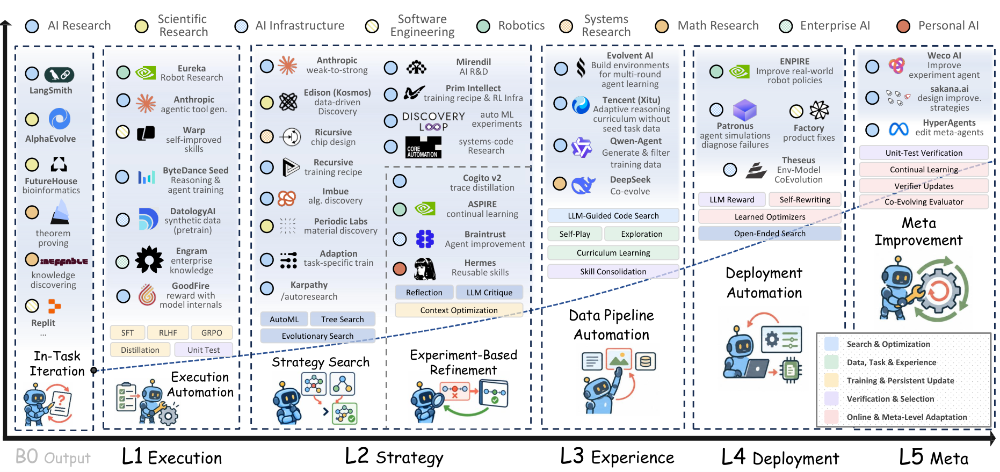
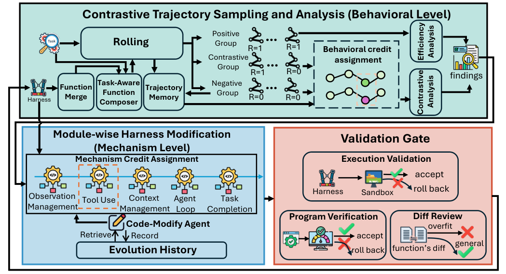
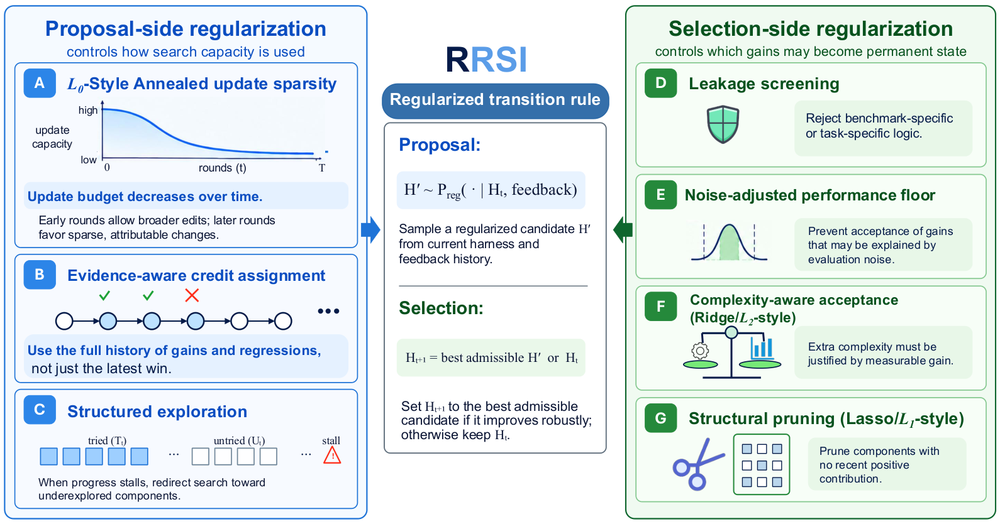
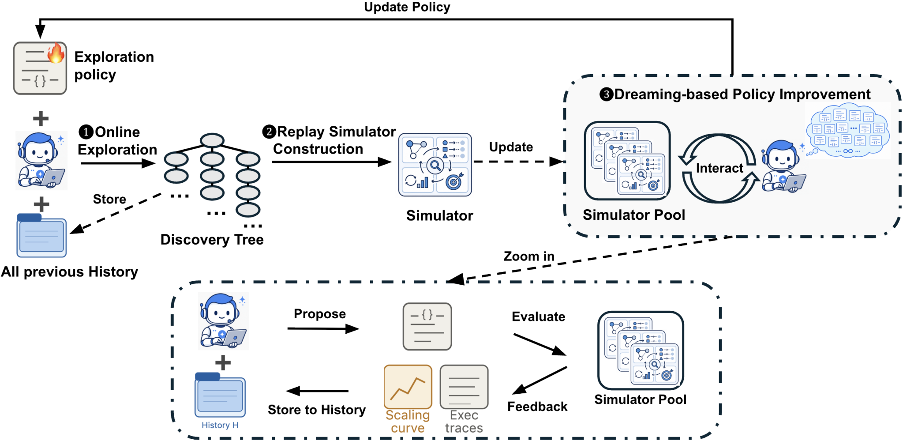

# 自己進化（Self-Evolution）研究トレンド（2026年9月）

> 対象：[self-evolution](../../capabilities/adaptation/self-evolution.md) の 2026年9月論文（14本、うち9本が「再帰的自己改善（RSI）」節）。全論文の arXiv HTML 本文を読み、背景・考察・限界まで踏まえてまとめた。

## この号の位置づけ（先月からの差分）

[8月](../aug_2026/self_evolution_trends.md)は RSI が**測定対象になった**号だった。AI4AI-Bench と What is Missing from AI Post-Training AI が独立に「自己改善は実行の層で回り、戦略の層に届かない」と診断し、処方はまだない、というところで終わっている。

9月は本数が同じ14本で、そのうち9本が RSI 節に入った。RSI はもはや自己進化の一節ではなく、このカテゴリの主題になっている。中身は大きく3つに分かれる。

1. **定義を固める論文が3本出た。** The Last AI Built by Humans が自律性の5段階（L1〜L5）を、Generalized Agent Iteration が「改善の仕組みが内側にあるか／評価基準が外に固定されているか」の2軸を、MetaRSI-v1 が「どの種類の検証器でループが閉じているか」を軸に、既存システムを整理した。3本とも、**改善手続きそのものを書き換えて初めて強い意味での RSI**だという線を引いている。
2. **ハーネスを再帰的に改善する論文が具体化し、過学習との戦いになった。** ModularRSI・RRSI・SIFT・Dream-RSI はいずれもハーネス（モデルの外側のコード）を改善対象にする。8月に「Meta-Harness 系の手法が出た」段階だったものが、9月は**改善が学習に使っていない別のベンチマークに移るか**を主眼に設計されている。結論は共通していて、編集できる範囲を広げるほど悪化し、絞ると移る。
3. **ハーネスの改善と重みの学習を交互に回す設計が複数出た。** ScienceBuddy、Experience Funnel、MetaRSI-v1。8月の OEO が「手順はオプティマイザに任せられるか」を問うたのに対し、9月は「テキストやコードに溜めた改善を、いつ重みに移すか」を問う。

一方、8月の「戦略の層に届かない」という診断に、9月の論文が答えたとは言えない。定義論文の物差しで測ると、今月の実装の多くは**改善手続きを人間が固定したまま、その内側で回る**ものだ。正面から「探索方策そのもの」を改善対象にしたのは Dream-RSI だけである。

> ※数値はモデルとデータの条件を添えて記す。1本の論文だけの結果は「要追試」として別にまとめた。

## 3行サマリ

- RSI 節が14本中9本を占めた。定義論文3本（The Last AI／Generalized Agent Iteration／MetaRSI-v1）は「次の改善を行う仕組みを改善して初めて強い RSI」という線で一致し、そのうえで既存システムの大半はまだその手前にあると整理した。
- ハーネスを再帰的に改善する手法は、過学習との戦いになった。ModularRSI は編集範囲を絞らないと初期ハーネスより悪化することを、RRSI は正則化しないと進化に使った課題だけが伸びることを示し、Growing Harness も検証用の別セットと巻き戻しを前提にしている。
- 改善の律速は評価のコストに移った。SIFT は LLM による対比較で、Dream-RSI は過去の探索木を再生するシミュレータで、毎回の本番評価を安い代わりの信号に置き換えている。

## クロス論文で見るトレンド

**継続する傾向（過去号からの延長）**

- **RSI への関心はそのまま強まっている。** 8月の AI4AI-Bench・Meta^n・What is Missing の流れを受け、9月は RSI 節が9本に増えた。8月に引用された RSIBench-Data（7月）は、今月 Generalized Agent Iteration の中で「改善は単調でない」証拠として再び使われている。
- **配備後に経験を構造として溜める路線も続いている。** Procedural Graphs（手順をグラフで持つ）、Closing the Consistency Gap（不安定な判断点を指針としてメモリに入れる）、AnyAct（ツールの信頼度をテスト時に更新する）、Growing Harness（制御ロジックをコードとして育てる）。いずれも重みを変えず、検証を通った変更だけを残す。手法の型は6〜8月と同じで、**同種の論文が出続けている**のが正直なところだ。

**今月明確になった点（複数論文で裏付け）**

1. **「強い RSI」の定義が収束しつつある。** Generalized Agent Iteration は、強化学習の一般化方策反復（GPI）と RSI を1つの枠組みで扱い、2つの軸で区別する——改善の仕組みがエージェントの外にあるか内にあるか、評価基準が外に固定されているか書き換えられるか。モデルの重み・プロンプトの雛形・外側のループ・検証器のどれか1つでも固定されていれば、それは「その仕組みの内側での改善（有界な洗練）」にとどまる。The Last AI は同じ区別を自律性の段階で表し、L1（人間が決めた改善手順を実行）から L5（以後の改善を支配する仕組み自体を変える）までを置く。MetaRSI-v1 は別の角度から、45の RSI システムの 69% が**機械が無料で採点できる目標**に対してループを閉じていると数えた。3本とも、現在の実装の多くは下位の段階にあるという見立てで一致する。8月の「戦略の層に届かない」という診断を、定義の側から裏づけた形だ。
2. **ハーネスの再帰的改善では、編集範囲を広げると移らない改善が増える。** ModularRSI はハーネスを5つのモジュール（エージェントのループ、ツール使用、観測の管理、コンテキストの管理、完了判定）に分け、モジュールごとに進化させる。ベンチマークと重ならない 2,000 タスクで進化させると、TerminalBench 2.0（DeepSeek-V4-Flash-Preview、初期ハーネス Terminus-2）で 47.57%→52.43% になる一方、モジュールに分けずに全体を進化させると 46.44%、全モジュールを同時に進化させると 44.19% と、**初期ハーネスより下がった**。RRSI は Harvey LAB で、正則化なしの進化が進化用の課題で 92.8 まで伸びるのに、学習に使っていない3ベンチマークの平均では 40.3（初期ハーネス 39.7）とほぼ動かないことを示した。正則化を入れると進化用の課題は 90.5 に下がるが、別ベンチマークの平均は 43.6 に上がる。Growing Harness も、直近の失敗だけを見る窓・関与した関数だけを触る範囲制限・別セットでの検証と巻き戻しを、すべて切り分けで効くと確認している。**どこを触ってよいかを狭めることが、移る改善の条件**という点で3本が揃った。
3. **自己改善の律速は評価のコストになり、代わりの安い信号が使われ始めた。** SIFT は、候補エージェントを毎回ベンチマークで測る既存手法のコスト（2万2千ドル超、数千 CPU 時間）を問題にし、LLM による対比較で順位をつけ、Bradley-Terry モデルで集約する。Polyglot では判定スコアと実際の正解率の順位相関が 0.68、TerminalBench では 0.72 で、本番評価の代わりとして使える程度には合っている。Dream-RSI は過去の探索木そのものを「再生できるシミュレータ」として保存し、別の探索方策を再実行なしで評価する。Lasso の正則化パス探索では、別の手法（SimpleTES）が 51,200 回呼んだ探索エージェントを 317 回に抑えた。Closing the Consistency Gap も、判断点ごとに30回再サンプリングするコスト（約30倍のトークン）を最大の制約として挙げている。評価器への繰り返しアクセスが「能力ではなく抜け道を報いる」危険は The Last AI と SIFT が別々に指摘しており、SIFT では実際に評価用ハーネスを緩める修正案が出てきたという。
4. **テキスト／コードに溜めた改善と、重みの学習を交互に回す。** ScienceBuddy は、ハーネスを固定した補助モデルが直す内側のループと、ハーネスを固定して GRPO で重みを更新する外側のループを入れ子にした。Experience Funnel は、経験をまずテキストの状態（スキル・手順）に蒸留し、検証を通ったもののうち「新たに役立つようになった振る舞い」だけを重みに移す。MetaRSI-v1 はデータ・ハーネス・モデルの3つの改善操作を1つの実行基盤に載せ、どの順に組み合わせてよいかを「直前の能力変化より後に作られた信号しか使わない」という規則で決める。3本とも、**テキストは速いが溜まり続け、重みは遅いが定着する**という役割分担を前提にしている。
5. **改善は単調ではないので、巻き戻しと検証ゲートが標準になった。** Generalized Agent Iteration が引く RSIBench-Data では、58.33% の設定が最初の有効な試行で改善する一方、最高値を出したあとも探索を続けた 78.26% が、より低い値で終わる。今月の手法はこれを前提にしている——Growing Harness（以前の能力を下げる変更を巻き戻す）、Procedural Graphs（検証で上がったときだけ採用）、RRSI（評価のノイズを超えない改善は採用しない）、ModularRSI（プログラム検査・差分の過学習チェック・抽出タスクでの実行検証）。The Last AI も「安全な継承」を3つの共通課題の1つに挙げる。

**単発だがインパクトの大きい結果（裏付けは弱め・要追試）**

- **Growing Harness**：WebArena-Verified で、ツール呼び出しのみの基準が Qwen3.5-4B で 6.7% に落ちるのに対し、育てたハーネスは 4B から gpt-oss-120b まで 44.7〜45.3% でほぼ一定。小さいモデルほど「制御をコードに移す」利得が大きいことを示唆するが、1本の論文の2ベンチマークでの結果である。
- **RSIAgent**：オープンモデル（GLM-5.3 が実行、Kimi-K3 が検証とカリキュラム）だけで、OSWorld 2.0 の部分点 71.97%→78.98% となり、GPT-6 Astra（72.60%）を上回ったと報告。重みは更新せず、自分で作った練習課題から得たメモリを凍結して使う。比較の条件（クローズドモデル側の設定）は著者らのものである。
- **ScienceBuddy**：Qwen3.5-4B から始めて、2サイクルで LitQA2・DbQA・ProtocolQA・GWAS の総合正解率が 42.2%→73.3%。生物医学の4課題族のみで、個々のスキル修正の寄与は切り分けられていないと著者自身が書いている。
- **Dream-RSI**：Terminal-Bench 2.1（Claude Opus 4.8＋Claude Code）でハーネスを 0.7247→0.8090 に改善し、Meta-Harness の報告値 0.79 を上回った。ただし評価セットが進化に使った課題と分離されているかは明記されていない。

## 数字で見るインパクト

| 論文 | 数字 | 初見の読み方 |
|---|---|---|
| MetaRSI-v1 | 45の RSI システムの 69% が機械採点できる目標でループを閉じる。55の閉ループのうち 53 が検証器の段階 1〜3（実行テスト・シミュレーション・結果の再現） | RSI が回っているのは「正解を機械が無料で判定できる」領域だけ。専門家の採点や実験装置が要る領域では、ほぼ回っていない |
| Generalized Agent Iteration（RSIBench-Data を引用） | 58.33% が最初の有効な試行で改善、最高値の後も探索を続けた 78.26% はより低い値で終了 | 自己改善は単調ではない。止めどきと巻き戻しがなければ、最終状態は最良状態より悪い |
| ModularRSI | TerminalBench 2.0（DeepSeek-V4-Flash-Preview、初期ハーネス Terminus-2）47.57%→52.43%。分割しない進化 46.44%、全モジュール同時 44.19% | 改善範囲を絞ると +4.9pt、絞らないと初期ハーネスより悪化 |
| 同上 | TerminalBench で進化させたハーネスが SWE-Bench-Verified で 75.80%（初期 73.40%）、GLM-5.2 に移すと +2.25pt | 別のベンチマーク・別のモデルにも一部移る |
| RRSI | Harvey LAB（Claude Opus 4.8）：正則化なしは進化用 92.8／別ベンチマーク平均 40.3、RRSI は 90.5／43.6（初期ハーネス 89.4／39.7） | 別ベンチマークでの初期比は正則化なし +0.6、RRSI +3.9。正則化なしの伸びはほぼ進化用の課題への適合 |
| 同上 | 試行あたりのトークン 242万（AHE は 380万） | 汎化を良くしながら、推論コストも下がる |
| SIFT | Polyglot（o3-mini）35.1%、DGM の報告 30.7%。所要 約50 CPU時間・実時間5時間。Qwen3-30B の実行で API 費用 34.3ドル（既存手法は2万2千ドル超と著者） | 評価を LLM の対比較に置き換えると、自己改善の探索が研究室の予算で回る |
| 同上 | 判定スコアと実正解率の順位相関 0.68（Polyglot）／0.72（TerminalBench） | 本番評価の代わりとして「順位づけ」には使える程度 |
| Dream-RSI | Lasso 正則化パス探索で探索エージェントの呼び出し 317回（SimpleTES は 51,200回、Gemini-3.1-Pro） | 過去の探索を再生して方策を評価すれば、同等の結果に必要な呼び出しが2桁以上減る |
| 同上 | GPU カーネル（VGG16）で、固定の探索方策と同等の性能に必要な生成数が 2.43倍少ない | 「探索のしかた」を改善対象にすると、同じ予算で深く探れる |
| Growing Harness | ツール呼び出しのみの基準と比べ LLM 呼び出し −76.0〜91.8%、推論コスト −74.4〜98.6%（BrowseComp-Plus／WebArena-Verified、gpt-oss-120b/20b・Qwen3.5-4B） | 繰り返し出てくる制御は、毎回モデルに考えさせずコードとして持てば安い |
| ScienceBuddy | Qwen3.5-4B、2サイクルで 42.2%→73.3%。ハーネス単独で検証正解率 31.1→51.1%、重み単独で pass@4 48.3→67.8% | ハーネスと重みの改善は互いに代替ではなく、足し合わさる |
| Experience Funnel | SearchQA（Qwen3.5-4B）で、テキストの状態なしの方策が 58.1%→61.3%（5ラウンド） | 経験の一部が、テキストを外しても残る形で重みに移っている |
| Closing the Consistency Gap | AppWorld（GPT-4.1, ReAct）で5回すべて成功する割合 53%→69%（平均成功率 77%→約81%） | 平均はほぼ同じでも「毎回成功する」割合が大きく上がる——自己進化の目的変数を平均から再現性へ |
| Procedural Graphs | EnterpriseArena で全期間を生き残る割合 44%→58%（Claude Sonnet 4.6）、6%→34%（Gemini 3.1 Pro） | 長い期間の課題で、手順を明示的に持つと脱落が大きく減る |

## 論文紹介（サブテーマ別）

### ① RSI とは何か——定義を固める3本

[The Last AI Built by Humans: Toward Genuine Recursive Self-Improvement](https://arxiv.org/abs/2609.11873)

基盤モデルの開発は、専門家によるデータ整備、事後学習の計算（著者は DeepSeek-V3.2 の事後学習が事前学習の計算の1割を超えたことを挙げる）、配備後の人手による診断と修正という、3つの点で人間の調整に依存したまま拡大している。著者の主張は、この調整を外部の人間が担い続ける限り、能力の継続的な向上は伸ばしきれないというものだ。

そこで RSI を「何が変わるか」「誰が変化を制御するか」「何が引き継がれるか」の3つで分け、自律性を5段階に並べる。L1 は人間が決めた改善手順を AI が実行する段階、L2 は改善の戦略を AI が選ぶ段階、L3 は次の改善に必要な経験やデータを AI が決める段階、L4 は統治の制約下で配備のフィードバックから適応する段階、L5 は以後の改善を支配する仕組みそのものを変える段階である。科学・身体性・ソフトウェア開発・医療の各領域と、8つの産業システムをこの段階に当てはめている。考察では、共通する課題として**安全な継承**（以前の能力を壊さない）、**自律性の帰属**（どの判断を本当に AI が下しているか）、**信頼できる検証**（評価器に繰り返し触れると抜け道が報われる）の3つを挙げ、実証されたすべてのシステムで改善の仕組みは部分的に人間の管理下に残っていると明言している。

> 図（The Last AI Built by Humans）：RSI の自律性を L1（実行）から L5（メタ改善）まで並べ、各段階に既存の研究・産業システムを対応づけている。（[論文](https://arxiv.org/abs/2609.11873)）

[Generalized Agent Iteration: One Formal Framework for Iterative Policy Improvement and Recursive Self-Improvement](https://arxiv.org/abs/2609.13406)

方策の反復改善には一般化方策反復（GPI）という形式的な枠組みがあるのに、RSI にはない。そのため「自己改善」という語が、出力を直すエージェントから自分のコードを書き換える系まで、大きく異なる野心に緩く使われている——これが動機である。

提案する枠組みは2つの軸を持つ。1つは改善の仕組みがエージェントの外にあるか内にあるか、もう1つは評価基準が外部に固定されているか書き換えられるか。内側にある場合は、評価基準が外部に固定された型（STOP、Gödel Agent）、基準が動いてしまう型（Red Queen Gödel Machine）、外部の基準をまったく持たない型（Schaul の提案）の3つに分かれる。区別の基準は明快で、重み・プロンプトの雛形・外側のループ・検証器のどれかが固定されていれば「その仕組みの内側での改善」、**次の改善を実行する仕組みそのものを改善して初めて強い意味の RSI**とする。評価する対象と評価する道具が一致すると外部の検証の独立性が失われる、という欠陥の整理が、今月の他の論文が置く検証ゲートの理論的な裏づけになっている。実験はない理論の論文で、到達可能性や計算量については何も主張しないと著者が明記している。

[MetaRSI-v1](https://arxiv.org/abs/2609.06396)

45の RSI システムを調べ、69% が機械が無料で採点できる目標でループを閉じていること、22領域・55の閉ループで、ループが成立するかどうかは能力よりも**検証器の種類**と相関すること（順位相関 −0.75）を示した。検証器を5段階（実行テスト、シミュレーション、結果の再現、実験装置での手順実行、正解のない専門家の採点）に分けると、55のうち 53 が最初の3段階にある。そのうえで、データ・ハーネス・モデルの3つの改善操作を1つの実行基盤に載せ、その順序を決める方策と、その方策自体を書き直す層を重ねた3段の入れ子を提案する。「データを増幅する操作は、新しい知識の源ではない（自己整合性を保証するだけ）」という整理は重要だ。ただし、今回確認できた本文には自身のシステムの定量結果が見当たらず、構成の提案として読むのが妥当である。

### ② ハーネスを再帰的に改善する——移る改善をどう選ぶか

ハーネスの設計としての側面は[ハーネス号](harness_trends.md)で扱う。ここでは自己改善のループとしての設計——何を触らせ、何を採用し、何を捨てるか——に絞る。

[ModularRSI: Modular and Generalizable Recursive Harness Self-Improvement](https://arxiv.org/abs/2609.14857)

既存のハーネス進化は、評価に使うベンチマークの上で進化させるため、再利用できる改善とそのベンチマークへの適合を区別できない。しかも課題単位の報酬は粗く、ハーネスのどの部分を、どの振る舞いのために変えるべきかを教えない。ModularRSI はこの2段の信用割り当てを分けて解く。ハーネスを5つのモジュールに分け、同じ課題の成功軌跡と失敗軌跡を対比し、複数の課題で繰り返し現れる欠陥だけを投票で選んで、対象モジュールだけを修正する。進化には、GitHub・Hugging Face・Kaggle などから集めた**評価ベンチマークと重ならない 2,000 タスク**を使う。

結果は、TerminalBench 2.0 で 47.57%→52.43%、SWE-Bench-Verified で 73.40%→76.40%。同じ予算の Meta-Harness（49.44%）と AHE（49.81%）を上回る。最も示唆的なのは切り分けで、分割しない進化（46.44%）も全モジュール同時の進化（44.19%）も初期ハーネスを下回った。著者は「ベンチマークと分離した進化では、より多くを変えられることが、適応を改善するよりも信用割り当ての曖昧さを増やす」と書いている。進化データは難易度が均衡しているほど対比が有益になるという観察もある。

> 図（ModularRSI）：モジュールに限定した進化、成功・失敗軌跡の対比、モジュール間の統合からなる流れ。（[論文](https://arxiv.org/abs/2609.14857)）

[RRSI: Regularized Recursive Self-Improvement of Agent Harnesses](https://arxiv.org/abs/2609.24972)

テスト時のハーネス進化は、有限の進化用セットからのフィードバックで編集を提案・選択し続けるので、適応的な過学習の危険を抱える。原因はベンチマーク固有の当てはめ、評価のノイズの追いかけ、不要な複雑さの蓄積の3つだと著者は整理し、それぞれに統計学の正則化に倣った制約を当てる。提案の側では、1回に束ねる編集の数をラウンドごとに減らし（L0 風）、過去に反証された仮説を再び試さないよう編集履歴を追い、停滞したら未探索の部品に予算を回す。選択の側では、ベンチマーク固有のロジックを評価前に批評役が弾き、評価のノイズを超えない改善は採用せず、推論コストの増加に見合わない改善を拒み（L2 風）、最近貢献していない部品を刈り込む（L1 風）。

コーディング・業務ワークスペース・工学設計の3領域8ベンチマークで、進化用の課題では Terminal-Bench 2.1 が 74.2→80.2（初期ハーネス比）、学習に使っていない課題でも SWE-bench +1.8、Frontier-Eng +4.3 などが得られた。Harvey LAB の切り分けが要点で、正則化なしでは進化用 92.8 と最も高いのに、別の3ベンチマークの平均は 40.3 で初期ハーネス（39.7）とほぼ変わらない。RRSI は進化用で 90.5 と少し譲り、別ベンチマークで 43.6 を得る。限界として、重みを固定した設定に限ること、進化用セットの質とハイパーパラメータに依存することを挙げる。

> 図（RRSI）：提案側の正則化（編集予算の減衰・証拠に基づく信用割り当て・構造化された探索）と、選択側の正則化（リーク検出・ノイズを考慮した採用基準・複雑さの制御・刈り込み）。（[論文](https://arxiv.org/abs/2609.24972)）

[Self Improvement via Fast Tree-search (SIFT)](https://arxiv.org/abs/2609.19526)

コーディングエージェントが自分の実装を書き換える RSI は、候補ごとにベンチマーク一式で検証するため高くつく。SIFT は、新しい候補を既存の候補と LLM に対比較させ、勝敗を Bradley-Terry モデルで集約した強さで親を選ぶ。展開と評価を待ち合わせない構成にして並列化も進めた。Polyglot で o3-mini を使い 35.1%（DGM の報告値 30.7%）、約50 CPU 時間・実時間5時間。ただし著者自身、既存手法との比較はモデルの版が揃っていないと注記している。最終確認にはやはりベンチマークが要り、判定役にはコーディング役より強いモデルが必要になる。評価用ハーネスを緩める修正案が実際に出てきたため、書き込める範囲の制限で防いでいる。自己改善を「測る仕組み」の角度からは[評価号](evaluation_trends.md)、コーディングエージェントとしての側面は[コーディングエージェント号](coding_agents_trends.md)も参照。

### ③ 探索方策そのものを改善する

[Dream-RSI: Recursive Self-Improvement through Evolving Worlds](https://arxiv.org/abs/2609.14858)

長期の発見課題では、提案と評価のサイクルが数千回に及ぶのに、既存のシステムは固定の探索方策で回る。探索方策をオンラインで改善しようにも、方策の良し悪しは多くのサイクルを経ないと分からず、メタレベルのフィードバックは遅くて高い。Dream-RSI はここを突く。完了した探索木を、別の方策でたどり直せる「再生シミュレータ」として保存する。方策の判断がそれまでに開いた節点とその記録だけに依存する限り（著者の言う、接頭部だけで観測できる判断）、別の方策を同じ木の上で再実行なしに評価できる。候補方策をこの「夢」の中で評価し、最良のものを本番に戻し、新しい探索木がまたシミュレータの在庫を増やす。

GPU カーネル・数理最適化・アルゴリズム設計・ハーネス最適化の4領域9課題で、固定の探索方策と比べて同等の性能に必要な生成数が 1.79〜2.43倍少なく、Lasso では SimpleTES の 51,200 回に対し 317 回の呼び出しで済んだ。複数ラウンドの探索木を溜めたほうが単一ラウンドより良い（ConvDiv で 1.90 対 1.59）。8月の診断に照らすと、今月唯一「改善の手続き」の側を対象にした実装だが、ベースのエージェントと評価器は変えない。数理最適化での利得はわずかで、履歴の多様性が足りないと少数の再生世界に過適合すると著者は述べる。

> 図（Dream-RSI）：オンライン探索で得た探索木を再生シミュレータに変え、その中で候補方策を評価（夢）してから本番に戻す再帰ループ。（[論文](https://arxiv.org/abs/2609.14858)）

[RSIAgent: Autonomous Exploration for Recursive Self-improvement in New Environments](https://arxiv.org/abs/2609.15364)

新しい環境のインターフェースや失敗の仕方は事前学習で捉えきれず、人手で学習データを集めるのは非公開の環境や変わり続ける環境では現実的でない。RSIAgent は、練習課題を作るカリキュラム役、環境で動く実行役、結果を独立に確かめる検証役の3者で、環境を広く並行して探る段階と、難しいケースを順に深掘りする段階を組み合わせ、得た手順や制約をメモリに書き、最後に凍結して本番の課題に使う。切り分けでは両方の段階を使うと平均 74.54%、広く探るだけで 65.52%、深掘りだけで 56.50%。失敗の分析は、狙いの甘い探索、要件を見落とす検証、誤ったルールの定着という3つの機構を挙げている——検証役の誤りが連鎖する点は、①の「信頼できる検証」の論点そのものだ。

### ④ ハーネスと重みを交互に改善する

[ScienceBuddy: Recursive-in-Recursive Self-Improvement for Interactive Scientific Agents](https://arxiv.org/abs/2609.17523)

会話の中で答えを直しても、それは体系的な改善にならない。ScienceBuddy は研究者との協働の記録を、採点基準つきの実行可能な課題に変換し、2つのループを入れ子にする。内側では、固定の補助モデルが失敗を診断し、指示・スキル・コンテキスト設定の限られた範囲でハーネスを修正する（評価が上がったときだけ採用、モデルは固定）。外側では、ハーネスを固定したまま、課題ごとの採点基準を報酬に GRPO でモデルを学習し、更新したモデルでまたハーネスを適応させる。Qwen3.5-4B、4課題族895問で、ハーネスの適応だけで検証正解率 31.1→51.1%、重みの学習だけで pass@4 48.3→67.8%、2サイクル合わせて 42.2%→73.3%。科学エージェントとしての位置づけは[AI 科学者号](ai_scientist_trends.md)を参照。

[Experience Funnel: A State–Policy Alternating Loop for Self-Evolving Agents](https://arxiv.org/abs/2609.08919)

テキストの状態は速く適応できるが際限なく溜まり、重みは定着するが更新が遅い。Experience Funnel はまず経験をテキストの状態に蒸留して検証し、そのうえで「状態なし／前の状態／更新した状態」の3条件で振る舞いを比べ、**新たに役立つようになった、または一貫して役立っている判断**だけをトークン単位で特定して重みに移す。SearchQA で、テキストの状態を外した方策そのものが 58.1%→61.3% に上がり、状態と方策を組み合わせて 62.4%（SkillOpt 61.1%）。切り分けでは状態だけ 61.1%、方策だけ 62.8%、両方 63.6%。繰り返しの課題と十分なフィードバックがある配備後の設定向けで、一回きりの課題には向かないと著者は明記する。スキルとして溜める側の議論は[スキル号](skills_trends.md)。

### ⑤ 配備後に構造として溜める——継続する路線

[Grow the Harness, Not the Context](https://arxiv.org/abs/2609.26760) は、インターフェースだけを持つ空の足場から始めて、失敗の関数単位の実行記録をもとに制御ロジックをコードとして育てる。繰り返し出てくる制御を毎回モデルに推論させるのではなく、再利用できるコードに移すという発想で、LLM 呼び出しを 76.0〜91.8% 減らした。[Procedural Graphs](https://arxiv.org/abs/2609.09153) は手順を「手順・関係・手順」の三つ組のグラフで持ち、失敗と成功の軌跡を比べて節点と辺を編集し、検証で上がったときだけ採用する。空のグラフから進化させても人手で設計したグラフに並び、有害な専門家の事前知識を修復できたという。[Closing the Consistency Gap](https://arxiv.org/abs/2609.08832) は自己進化の目的を平均の成功率から**毎回成功する割合**に移し、出力分布が平らな判断点を見つけて指針に変える。[AnyAct](https://arxiv.org/abs/2609.37025) は大量の MCP ツールについて、実行の成否から信頼度をテスト時に更新し、信頼できないツールの順位を下げる（LiveMCPBench、DeepSeek-V3 で素朴な基準の 42.11% に対し 84.95%）。ただし順位を下げたツールが唯一の解決手段だったケースで、以前成功した課題が失敗に転じることがあると著者は認めている。

## 論点・未解決課題

1. **今月の実装は、定義論文の物差しでどこにいるのか。** Generalized Agent Iteration の基準では、改善手続き（検証ゲート・採用規則・進化ループ）を人間が固定している ModularRSI・RRSI・SIFT・Growing Harness は「その仕組みの内側での改善」にあたる。The Last AI の段階でも、多くは L1〜L2 に収まる。探索方策を改善対象にした Dream-RSI でさえ、評価器とベースのエージェントは固定だ。8月の「戦略の層に届かない」という診断は、9月の実装によって覆されてはいない。
2. **汎化を守る制約と、RSI の「自由度」は両立するのか。** ModularRSI と RRSI は、編集範囲を絞り採用基準を厳しくすることで移る改善を得た。一方、強い RSI の定義は「改善の仕組みそのものを変えられること」を要求する。改善の手続きまで書き換えられるようにすれば、RRSI が抑えた適応的な過学習が上の層で再び起きうる。Generalized Agent Iteration の言う「評価する対象と評価する道具が一致する」問題であり、今月の論文はこの両立を扱っていない。
3. **安い代わりの信号はどこまで信用できるか。** SIFT の順位相関 0.68〜0.72 は順位づけには十分だが、評価用ハーネスを緩める修正案が実際に出ている。Dream-RSI の再生は、接頭部だけで観測できる判断に限られる。The Last AI の「評価器への繰り返しアクセスは抜け道を報う」という指摘と合わせると、評価コストを下げるほど評価の独立性の設計が重くなる。
4. **検証器のない領域へ RSI は広がるのか。** MetaRSI-v1 の集計では、55の閉ループのうち 53 が実行テスト・シミュレーション・再現の段階にある。ScienceBuddy は研究者の協働から採点基準を作ることで一歩踏み出したが、これは専門家の採点を報酬に変える試みで、MetaRSI-v1 が最上位に置く「正解のない専門家の採点」そのものにはまだ届いていない。
5. **テキストから重みへ、いつ・何を移すか。** ScienceBuddy・Experience Funnel・MetaRSI-v1 は交互に回す点で一致するが、移す基準はそれぞれ違う（評価が上がった変更／新たに役立つ判断／信号の鮮度）。どれも 4B 級のモデルか、定量結果のない構成の提案で、大きいモデルでの検証はない。

## 次に来るもの（Watch next）

- **改善手続きを改善する実装。** 定義が揃ったので、次は L5（改善の仕組み自体を変える）を実際に測る論文が出るはずだ。そのとき RRSI 型の正則化を上の層にも掛けられるかが焦点になる。
- **ベンチマークと分離した進化データの標準化。** ModularRSI の 2,000 タスクのような「進化用で評価と重ならない」データが、AI4AI-Bench（8月）や RSIBench-Data（7月）と並ぶ共通の資源になるか。
- **代わりの信号の検証。** LLM による対比較・再生シミュレータ・一貫性の再サンプリングといった安い信号と、本番評価との乖離を体系的に測る研究。[評価号](evaluation_trends.md)の主題と重なる。
- **テキストと重みの交互ループの大型化。** 4B 級で示された相補性が、より大きいモデルでも成り立つか。

---

*本ニュースレターは各論文の arXiv HTML 本文を精読してまとめた（14本すべて HTML で取得。MetaRSI-v1 は取得できた本文に自身の実験の定量結果が含まれていなかったため、構成の提案として扱った）。図は `newsletters/assets/` に保存。対象＝[capabilities/adaptation/self-evolution.md](../../capabilities/adaptation/self-evolution.md) の 2026年9月分（14本）。関連号：[8月自己進化](../aug_2026/self_evolution_trends.md)・[9月ハーネス](harness_trends.md)・[9月評価](evaluation_trends.md)・[9月 AI 科学者](ai_scientist_trends.md)・[9月コーディングエージェント](coding_agents_trends.md)・[9月スキル](skills_trends.md)。*
