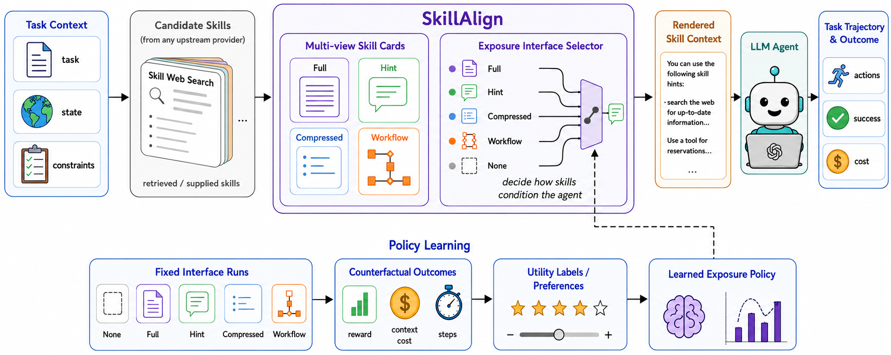
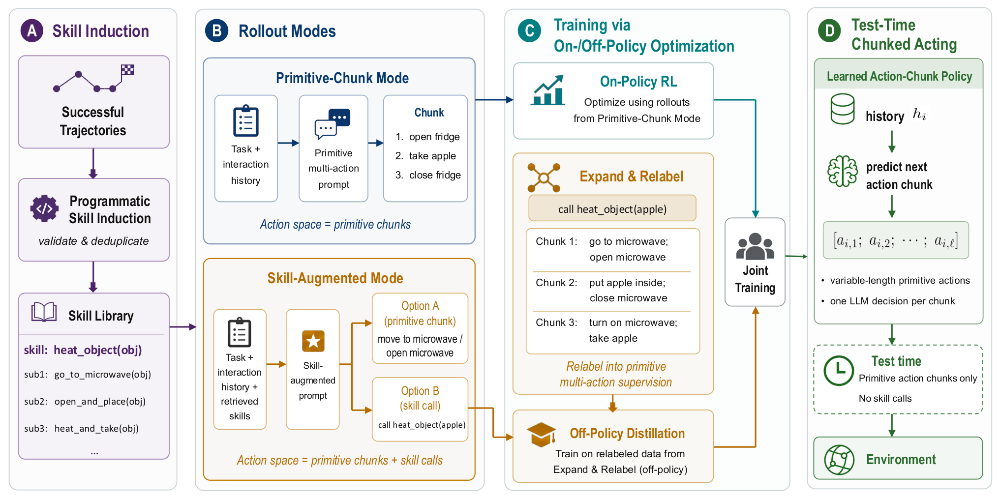
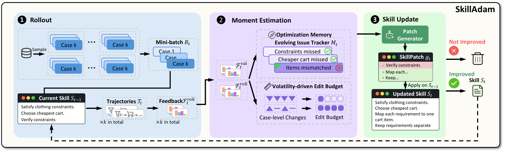
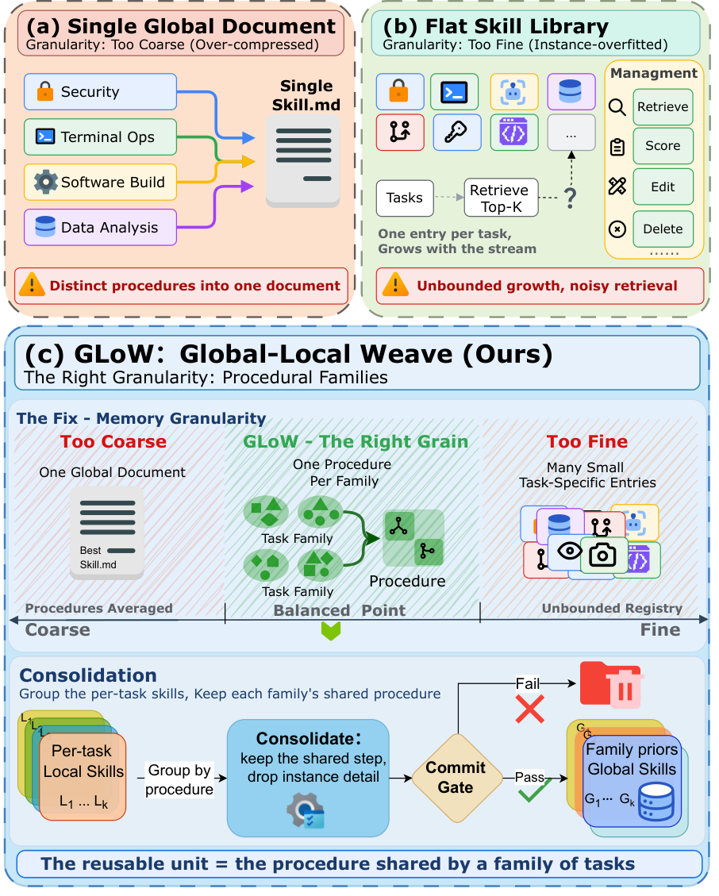

# エージェントスキル（Agent Skills）研究トレンド（2026年9月）

> 対象：[skills](../../capabilities/action/skills.md) の 2026年9月論文（7本）。7本すべて arXiv HTML 本文を読み、背景・考察・限界まで踏まえてまとめた。

## この号の位置づけ（先月からの差分）

[8月号](../aug_2026/skills_trends.md)は、スキルが効くのは知識を足すからではなく**手順を安定させるから**だ（Demystifying Agent Skills）という作用点の特定と、プールが大きくなると正しいスキルを選べなくなるという規模の問題で締めくくった。「作る問題は解けかけているが、選ぶ問題が未解決」というのが先月の結論だった。

9月はその先の問いに移った。**選んだスキルを、どういう形でエージェントに渡すか**である。同じスキルでも、全文を文脈に入れるか、要約にするか（SKILLALIGN）、別の文脈で走るサブエージェントにするか（Subagents vs Agent Skills）、実行環境を組む側のモデルに渡して道具や状態に変えさせるか（Meta-Skills for Harness Design）、さらには学習で方策の中に溶かし込んでしまうか（Act More, Decide Less）。4本が独立に「**スキルの中身だけでなく、渡し方が成否を左右する**」という同じ結論に達した。先月までの「SKILL.md をそのまま文脈に読み込ませる」という暗黙の前提が、今月は明示的に問い直されている。

もう一つの変化は、スキルの進化を**最適化として扱う**論文が揃ったことだ。SKILLADAM は Adam のモーメント推定を離散的なスキル編集に持ち込み、SkillGLoW は個々のタスクのスキルを「手順の族」に統合し、実行で劣化しないものだけを採用する関門を置く。両者とも SkillOpt を比較対象にしており、スキル最適化の比較基盤ができつつある。一方で、人間が実際にどうスキルを保守しているかを追跡した Who Maintains Agent Skills? は、人間の保守は追記が中心で統合や廃止はほとんど行われず、しかも保守後の版が初版より良いとは測定できなかったと報告した。自動化側が「統合」に向かうのと、人間の現場が「追記」に偏っているのとが、今月ははっきり対照をなしている。

> ※数値はモデルとデータの条件を添えて記す。1本の論文だけの結果は「要追試」としてまとめた。

## 3行サマリ

- スキルの「渡し方」が中身と同じくらい効くことが、4本で独立に示された。全文を入れるより要約のほうが良い場合がある（SKILLALIGN）、入出力の契約を持つスキルは別文脈のサブエージェントで動かすほうが良い（Subagents vs Agent Skills）、実行するモデルではなく環境を組むモデルに渡すほうが良い（Meta-Skills）。
- 先月の規模の問題は「全部入れると素の実行より悪くなる」という形で再確認された。スキル 1,000 件を全文で入れると ALFWorld で素の実行を下回り（SKILLALIGN）、無関係なツールが増えるほど文脈に読み込む方式は劣化する（Subagents vs Agent Skills）。
- スキルの進化は、検証つきの最適化として整理されはじめた（SKILLADAM・SkillGLoW）。ただし人間による実際の保守は追記中心で、統合や廃止はわずかしかなく、保守後の版が良くなったとは測定できなかった（Who Maintains）。

## クロス論文で見るトレンド

**継続する傾向（過去号からの延長）**

- **スキルの自動進化**は[6月](../jun_2026/skills_trends.md)・[8月](../aug_2026/skills_trends.md)から続く。今月は SKILLADAM と SkillGLoW の2本で、どちらも「1回ごとの貪欲な書き換え」をやめ、改善の履歴を蓄積したり、実行で劣化しないことを採用の条件にしたりする方向をとる。8月の SkillHEX（証拠に基づく木探索）と同じく、**場当たり的な書き換えから、検証を伴う探索・最適化へ**という流れである（[自己進化号](self_evolution_trends.md)も参照）。
- **規模がボトルネックになる**という8月の指摘も続いている。今月は SKILLALIGN がライブラリを 200→2,000 件と変え、Subagents vs Agent Skills が無関係なツールの数を増やし、SkillGLoW がタスクごとにスキルを追加する方式のライブラリが際限なく大きくなることを問題にした。

**今月明確になった点（複数論文で裏付け）**

1. **スキルの効果は、渡し方によって大きく変わる。**（SKILLALIGN／Subagents vs Agent Skills／Meta-Skills for Harness Design／Act More, Decide Less）
   SKILLALIGN は、課題とエージェントと候補スキルを固定したまま、見せ方だけ（全文・ヒント・要約・ワークフロー・なし）を変える反実仮想の比較を行った。ALFWorld（MiniMax M2.7、スキル 1,000 件）では、全件を全文で見せると 47.9% で、素の実行（50.7%）を下回る。同じ全件を要約で見せると 72.1% になる。検索で上位 k 件に絞った条件でも最適な見せ方は場面によって変わり、課題ごとに最適な見せ方を選べた場合の上限は 92.9% と、固定した最良の見せ方（75.0%）より大きく上にある。
   Subagents vs Agent Skills は、同じスキルを「文脈に読み込んで主エージェントが従う」か「新しい文脈で動くサブエージェントとして呼び、出力だけ受け取る」かで比べた。SkillsBench の人手で書かれたスキル（入出力が明示されていない）では文脈に読み込む方式が同等以上だったが、成功軌跡から合成した**入出力の契約つきの手順スキル**ではサブエージェントのほうが良く、その差はコンテキストの容量に余裕のない小さなモデルほど大きかった。
   Meta-Skills for Harness Design は、同じスキル集を実行モデルに直接渡すより、実行環境（ハーネス）を組む Builder モデルに渡して道具・状態・検証ロジックに変換させたほうが、6つのモデル×ベンチマークの組すべてで良く、平均 12.02 ポイント、最大 25.43 ポイント上回った。
   Act More, Decide Less（Space）はさらに極端で、スキルは学習時の教師としてだけ使い、配備時にはスキルライブラリを一切参照しない。
   4本を並べると、8月の「スキルは手順の錨として効く」という結論に条件がつく。**錨として効くのは、手順が適切な形で渡されたときだけ**で、全文をそのまま積み上げると錨より雑音として働く。

2. **文脈に積み上げる方式は、規模とともに劣化する。**（SKILLALIGN／Subagents vs Agent Skills／SkillGLoW）
   SKILLALIGN では、ライブラリが大きくなるにつれ全文で見せる方式が急に悪くなり（スキル 1,000 件で 47.9%）、要約で見せる方式は比較的安定していた（同 72.1%）。2,000 件では要約でも雑音とコストが増えて再び下がる。Subagents vs Agent Skills では、課題に関係のないツールの説明を文脈に足していくと、文脈に読み込む方式のほうが早く崩れ、サブエージェント方式は緩やかに劣化した。SkillGLoW は、タスクごとにスキルを足していく平らなライブラリが課題の流れに比例して膨らみ、検索も雑音を含むようになる点を出発点にしている。8月の Demystifying（プール 5→100 件で実使用精度 29.6%→3.3%）と合わせ、**大規模ライブラリを一度に文脈へ入れる設計は、効かないだけでなく素の実行より悪くなりうる**ことが複数の論文で確認された。

3. **スキルの更新は、検証つきの最適化として組まれるようになった。**（SKILLADAM／SkillGLoW／Meta-Skills for Harness Design）
   SKILLADAM は、既存の自己進化手法が毎回その場の失敗だけを見て書き換える「SGD 的」な振る舞いをしており、以前に直した点が上書きされると指摘する。そこで、見つかった問題と対処の結果を記録し続ける課題台帳（Adam の1次モーメントに相当）と、ケースごとの改善のばらつきが大きいときは編集範囲を絞る仕組み（2次モーメントに相当）を入れた。SkillGLoW は、候補が実際の実行で既存ライブラリを劣化させないこと（許容幅 0.02）を採用条件とする関門を置き、関門を外すと平均改善が 14.7 から 9.6 ポイントに下がった。Meta-Skills も、Builder がハーネスを組み、実行記録を見て、証拠に基づいてスキル集を「維持・修正・追加」する。3本とも、**書き換えるかどうかを実行結果で決める**点で揃っている。

4. **再利用の単位は「1タスク」でも「全体で1文書」でもない。**（SkillGLoW／Subagents vs Agent Skills／Act More, Decide Less）
   SkillGLoW は、単一の SKILL.md にすべてを押し込むと多様な課題で一般論に潰れ、タスクごとのスキルは他の事例に移らないとし、**似た課題の集まりが共有する解き方の手順**（手順の族）を単位にした。Subagents vs Agent Skills は、入出力が明確な葉のスキルはサブエージェントとして、振り分けだけを担う上位のノードは文脈内で実行する混成方式が、平らな構成・すべて同一方式のどちらよりも一貫して良いと報告した。Space は成功軌跡を「複合スキル＋下位スキル呼び出し」の2層に切り出し、下位スキルの境界を行動のまとまり（チャンク）の境界として使う。8月の Break It Down（下位タスク単位のスキルは移り、タスク単位は移らない）と同じ方向で、**中間の粒度に構造を持たせる**ことが今月も支持された。

**単発だがインパクトの大きい結果（裏付けは弱め・要追試）**

- **人間による保守は、測れるほどの改善を生んでいない。** Who Maintains Agent Skills? は、公開5リポジトリの 254 件の実質的な編集を追跡し、6回以上編集された 13 スキルについて最新版と初版を 143 の転移課題で比べたところ、差は 5 段階評価で −0.09（95% 信頼区間 −0.28〜+0.10）で有意差がなかった。評価は LLM による判定で、判定者間の一致も事前に定めた基準を下回っており、1研究・小標本の結果である。
- **スキルを方策に蒸留すると、判断の回数が大きく減る。** Space は ALFWorld（Llama-3.1-8B-Instruct）で成功率 96.1%（既知）／94.5%（未知）を、LLM の呼び出し 5.0〜5.2 回で達成した（GiGPO は 89.1%／83.6%、14.5〜18.8 回）。テキスト環境2つ・小型モデル2つでの結果である。
- **契約のないスキルが大半。** Subagents vs Agent Skills は、SkillsBench の人手で書かれたスキルの大半が入出力を明示していないと報告し、契約つきのスキルを合成できたのは 87 課題中 64 課題だった。

## 数字で見るインパクト

| 論文 | 数字 | 初見の読み方 |
|---|---|---|
| SKILLALIGN | ALFWorld（MiniMax M2.7、スキル 1,000 件を全件提示）：全文 47.9%、要約 72.1%、スキルなし 50.7% | 全部を全文で入れると、何も入れないより悪い。同じスキルでも要約にすれば大きく改善 |
| 同上 | SkillsBench（GPT-5.3-Codex、全件提示）：全文 24.8、要約 30.8、スキルなし 27.4（平均報酬） | 別のベンチマーク・別のモデルでも同じ向き |
| 同上 | 検索上位 k 件・全文で 4.7〜9.0K トークン、ヒント・要約は 0.08〜0.30K トークン | 文脈コストは桁違いに小さいまま、同等以上の成績 |
| 同上 | ALFWorld で最良の固定提示 75.0%、DPO で学習した選択 78.6%、課題ごとの理想的な選択 92.9% | 見せ方を課題ごとに選ぶ余地は大きいが、学習した選択はまだその一部しか取れていない |
| Subagents vs Agent Skills | 強いモデル（GPT-5.3 Codex、Kimi K2.6）では、サブエージェント方式のほうが最大文脈長が短い課題が 8 割超 | 1つの文脈が抱える量を減らすという狙いどおりに働いている。代わりに総トークンは増える |
| Meta-Skills for Harness Design | 同じスキル集を Builder に渡すと、実行モデルに直接渡すより平均 +12.02、最大 +25.43pt（Harness-Bench／NewtonBench、3つの実行モデル） | 「読ませる」より「環境に組み込ませる」ほうが効く |
| 同上 | Gemini-3.6-Flash・Harness-Bench：素の環境 37.35% → スキルなし Builder 53.29% → スキル集つき Builder 67.81% | ハーネスを組むだけで上がり、スキル集でさらに上がる |
| SkillGLoW | 3モデル×4ベンチマークの 12 実行すべてで改善、平均 +17.2pt（スキルなし比） | どの組み合わせでも負けがない |
| 同上 | ライブラリはタスクごとのプールより 3.6 倍小さい。単一文書に統合すると +2.0pt、平らなプール＋検索は +5.0pt | 統合しすぎても、統合しなさすぎても効かない |
| SKILLADAM | DeepPlanning（Claude Sonnet 4.5）で 21.7%→28.3%（SkillOpt 比）、トークン 67.3% 減・API 呼び出し 68.8% 減 | 長い課題ほど差が開き、しかも安い。短い課題（SearchQA）では差 +0.2pt とほぼ同等 |
| Act More, Decide Less | ScienceWorld（Llama-3.1-8B-Instruct）：成功率 67.2% 対 GiGPO 35.9%、LLM 呼び出し 5.2〜5.8 回 対 10.1〜10.2 回 | 少ない判断回数で、成功率もほぼ倍 |
| Who Maintains | 254 件の編集のうち統合・廃止は 11 件（4.3%）、失敗の具体的な証拠を伴う編集は 24% | 人間の保守は「足す」一方で、削る・まとめる作業はほとんどない |

## 論文紹介

### ① 渡し方を変える——見せ方、実行の場所、渡す相手

[SKILLALIGN: Aligning Skill Interfaces for LLM-based Agents](https://arxiv.org/abs/2609.07255)

スキル研究は獲得・検索・圧縮・合成を扱ってきたが、いったん選んだスキルの見せ方は固定されているのが暗黙の前提だった。著者らは「同じスキルが、見せ方次第で助けにも、気を散らすものにも、誤導にもなる」と問題を立てる。スキルを全文・ヒント・要約（前提・制約・リスクなど）・ワークフロー・メタデータの多面的なカードに変換し、5つの見せ方（なし／全文／ヒント／要約／ワークフロー）で同じ候補を出し分ける。課題・エージェント・候補を固定して見せ方だけ変える反実仮想の比較が中心で、その結果から見せ方の選択方策を SFT と DPO で学習することも試した。

ALFWorld（140 エピソード）と SkillsBench（94 課題）、MiniMax M2.7・GPT-5.3-Codex・GLM-5 で、スキル 1,000 件の全件を全文で入れると素の実行より悪くなり、要約にすると大きく改善する（数字は表を参照）。要約の効果がただ短くなったからではないかを確かめるため、同じ長さの汎用要約とも比べ、12 条件の多くで構造化された要約が上回ったので、「短くしたこと」は効果の一部にすぎないと著者は結論している。限界として、見せ方は人手で設計した5種類に限られ、方策学習は実現可能性の確認にとどまり、理想的な選択（92.9%）とは大きな差がある。生成した要約が課題に必要な情報を落とした割合は 3.3〜6.7% だった。

> 図（SKILLALIGN）：候補スキルを多面的なカード（全文・ヒント・要約・ワークフロー）に変換し、どの見せ方でエージェントに渡すかを選ぶ。下段は固定した見せ方での実行結果から選択方策を学習する流れ。（[論文](https://arxiv.org/abs/2609.07255)）

[Subagents vs Agent Skills: Executing Reusable Knowledge for Long-Horizon Agentic Tasks](https://arxiv.org/abs/2609.09233)

Cornell と Microsoft Research Cambridge の研究。著者らはまず、エージェントスキルは強化学習でいう「スキル」（上位の制御器から呼ばれ、時間的に広がる方策）とは違い、呼び出しても SKILL.md が文脈に読み込まれるだけだと指摘する。課題が長くなるほど文脈が膨らみ、推論の質が落ちる。そこで、同じスキルパッケージを**新しい文脈で動くサブエージェント**として呼び、最終出力だけを主エージェントに返す方式と比べた。仮説は、スキルが入出力の契約と手順を備えているとき、つまり強化学習の options のように自己完結しているときにサブエージェント化が効く、というものだ。

SkillsBench（OpenHands 上、GPT-5.3 Codex・Qwen3.5 の 2B/4B/9B・Kimi-K2.6 など 8 モデル）で、人手で整備された元のスキル（契約なし）では文脈に読み込む方式が全モデルで同等以上だった。ところが、成功軌跡から合成した契約つきの手順スキル（64 課題分）では逆転し、サブエージェントが上回った。差は小さいモデルほど大きい。無関係なツールを足して初期の文脈を長くしていくと、サブエージェント方式のほうが緩やかに劣化する。代償として、サブエージェントは必要な情報を受け取る必要があるので、総トークンは大きく増える。付録では、振り分けを担う上位ノードは文脈内で、契約を持つ葉のスキルはサブエージェントで動かす混成方式が、4種類のライブラリ構成すべてで最良だった。主要な比較は図で示されており、本文に数値の表はない。著者が今後の課題として挙げるのは、主エージェントとサブエージェントの効率的なやりとりと、ライブラリが大きくなったときの「スキルライブラリのリファクタリング」である。

[Learning Meta-Skills for Agent Harness Design in Test-Time AI4AI](https://arxiv.org/abs/2609.38143)

エージェントの成績は推論能力だけでなく、動く環境にも依存する。この研究では、どちらのモデルも重みを固定したまま、Builder モデルが実行モデルのための環境（指示・メモリ・文脈の整理・道具・実行制御・検証と回復・作業場所の準備）を組み立てる。メタスキルは「いつ（支援が要る条件）・何を用意するか・どう使わせるか」の3項目で書かれ、Builder は開発用の課題でハーネスを組み、実行記録を見て、証拠に基づいてスキル集を維持・修正・追加する。

Builder に GPT-5.6-Sol、実行モデルに Gemini-3.6-Flash・Qwen3.8-Flash・GPT-OSS-120B を使い、Harness-Bench（テスト 95 課題）と NewtonBench（テスト 292 課題）で、スキル集を全部使う Builder がマクロ平均 65.31% を達成した。スキルなしの Builder より +8.95pt、同じスキル集を実行モデルに直接渡すより +12.02pt 高い。スキルの観点で重要なのは後者で、著者は利得の源を「知識を見せたこと」ではなく、**実行前に知識を永続的な状態・実行可能な道具・検証ロジックに変えたこと**に求め、メタスキルは解き手へのプロンプトというより「環境を組むための言語」として働くと述べる。BM25 で上位2件を検索して渡すより、全部渡すほうが良かった点も、検索で絞れば良いという単純な見方への反例になっている。限界は、開発用データが約1割・既知の課題カテゴリ内であること、修正を重ねても単調には良くならないこと（Harness-Bench の Qwen で最良時から 4.06pt 低下）、別の Builder への転移は信頼区間がゼロをまたぐこと。ハーネス設計の観点からの詳細は[ハーネス号](harness_trends.md)を参照。

### ② スキルを方策に溶かす

[Act More, Decide Less: Skill-Guided Adaptive Action Chunking for Long-Horizon LLM Agents](https://arxiv.org/abs/2609.02042)

ReAct 型のエージェントは1回の判断で1つの行動しか出さないため、長い課題では決まりきった手順にも判断の回数を費やす。かといって、複数の行動をまとめて出すように素朴に強化学習すると、1行動ずつに戻ってしまうか、長すぎるまとまりに賭けてしまう。まとまりの境界をどこに置くかを、最終報酬だけから学ぶのが難しいからだ。

Space はこの境界の情報をスキルから得る。成功軌跡を「複合スキル＋下位スキル呼び出し」の2層のプログラム的スキルに切り出し、下位スキルの境界をまとまりの境界とみなす。学習では、まとまりを直接出す実行と、スキル呼び出しを含む実行を交互に行い、後者を基本行動のまとまりに展開し直してオフポリシーの教師データにする。**配備時にはスキルライブラリを参照しない。** スキルは呼び出されるものではなく、方策の時間構造を教える教材として使われる。

ALFWorld と ScienceWorld、Qwen3-4B と Llama-3.1-8B-Instruct で、GiGPO などを上回りつつ LLM の呼び出し回数を大きく減らした（表を参照）。GRPO の最終性能に、学習ステップの 26.6% で到達する。限界として、テキスト環境に限られ、まとめて実行すると再計画の頻度が下がるので、確率的な環境や安全上重要な場面では危険になりうると著者自身が述べている。

> 図（Act More, Decide Less）：成功軌跡からプログラム的スキルを抽出し（A）、スキル呼び出しを含む実行を基本行動のまとまりに展開して学習に使い（B・C）、テスト時はスキルなしで可変長のまとまりを出す（D）。（[論文](https://arxiv.org/abs/2609.02042)）

### ③ スキルの進化を最適化として組む

[SKILLADAM: Stable and Efficient Skill Evolution for Agents](https://arxiv.org/abs/2609.08944)

専門家が書くスキルは高くつき、LLM が書くスキルはしばしば効かない。自己進化で埋めようとする既存手法は、その回の失敗だけを見て書き換える発見的な更新なので、最適化が不安定で反復効率も悪い。著者は課題を2つに分ける。効いた修正は上書きされずに積み上がるべき（方向の安定性）、そして直近の改善が一貫しているかに応じて書き換えの範囲を変えるべき（更新の適応性）。

これを Adam の考え方で解く。課題台帳は、見つかった問題・状態・過去の対処の結果を記録する最適化の記憶で、同じ失敗を何度も見つけ直すのを防ぐ（1次モーメントに相当）。ケースごとの改善のばらつきを測り、ばらつきが大きいときは次の編集範囲を狭め、小さいときは広げる（2次モーメントに相当）。改善しないパッチは捨てる。

GPT-5.5 で6ベンチマーク、Claude Sonnet 4.5 で DeepPlanning を評価し、SkillOpt・GEPA・TextGrad・Trace2Skill などと比べた。短い課題では差が小さく（SearchQA で +0.2pt、DocVQA で +1.1pt）、長い課題で大きい（ALFWorld +2.3pt、DeepPlanning +6.7pt）。DeepPlanning では使用トークンを 67.3% 減らした。GPT-5.5 で進化させたスキルを GPT-5.4-mini に移すと、平均 67.8%（SkillOpt は 63.1%）。限界として、台帳とパッチ生成は LLM の能力に依存すること、2つの仕組みの効果を切り分けきれていないこと、採用の基準がベンチマーク依存であることが挙げられている。

> 図（SKILLADAM）：実行（1）→ 課題台帳と改善のばらつきによる編集予算の更新（2）→ パッチの生成と採否の判断（3）を繰り返す。（[論文](https://arxiv.org/abs/2609.08944)）

[SkillGLoW: Procedural-Family Skill Consolidation for Self-Improving Agents on Long-Horizon Task Streams](https://arxiv.org/abs/2609.02217)

自分の実行から学んだスキルをどう整理するか。単一の文書にまとめると、支配的な解き方がない多様な課題では一般論に潰れる。タスクごとに足していくと、ライブラリは課題の流れに比例して膨らみ、他の事例に移らない。著者は、欠けている再利用の単位は**関連する課題の集まりが共有する解き方の手順**だと主張する。

各タスクの経験（指示・軌跡・検証スコア・学んだスキル）をカードにし、複数の埋め込みを使った合意クラスタリングで手順の族にまとめる。族ごとに、適用条件・中核の手順・失敗の様態だけを残して個別の事例の情報（家具の位置など）を落とした大域的な前提知識へ圧縮し、実際の実行で既存ライブラリを劣化させない候補だけを採用する。実行時は、族の前提知識とそのタスク自身から作る局所的なスキルを織り合わせる。

Terminal-Bench-Pro・SWE-bench Verified・ALFWorld・LiveMathematicianBench（各 32〜53 課題）で、DeepSeek-V4-Pro・MiniMax-M3・GPT-5.4-mini の 12 実行すべてで改善した（平均 +17.2pt）。改善は課題が最も多様な SWE-bench で大きい。単一文書型の SkillOpt との比較では 21 項目中 15 項目で上回り、SkillOpt が勝った4項目はすべて、支配的な手順が1つある ALFWorld だった。これは「単一文書は支配的な手順があるときだけ機能する」という著者の主張と整合する。限界として、転移は1つのベンチマークの課題カテゴリ内でしか示されておらず、別のモデルへの引き継ぎや本当の分野の移動は未検証である。

> 図（SkillGLoW）：(a) 単一文書は粗すぎて異なる手順を平均化し、(b) 平らなライブラリは細かすぎて際限なく増える。(c) 手順の族を単位に統合し、関門を通ったものだけを大域的なスキルとして残す。（[論文](https://arxiv.org/abs/2609.02217)）

### ④ 人間はスキルをどう保守しているか

[Who Maintains Agent Skills? A Longitudinal Study of Human-Governed Skill Evolution](https://arxiv.org/abs/2609.05677)
（HTML 版の題は "...of Human-Governed, AI-Assisted Skill Maintenance"）

自動のスキル整備の研究は、人手の保守を「規模が出ない」という理由で置き換え対象として扱ってきたが、その人手の保守が実際にどう行われているかは測られていなかった。Megagon Labs のこの研究は、getsentry・trailofbits・obra/superpowers・anthropics・cloudflare の5つの公開スキルリポジトリについて、2025年10月〜2026年6月の git 履歴（873 コミット、SKILL.md 143 件）から、実質的な編集 254 件を抽出し、事前登録した3つのコード表で分類した。

実質的な編集はすべて、名前のある人間のアカウントが作成またはマージしている。62% は AI の共著者の記載があり、組織によって 10% から 90% 超まで大きく異なる。編集の 60% は拡充、38% は修正で、内容の追加（72 件）と事実の訂正（56 件）が約半分を占める。**統合と廃止は 11 件（4.3%）しかない。** 120 スキルのうち 32 件がトークン長で 10% 超増え、10% 超縮んだのは 7 件。具体的な失敗の証拠を伴う編集は 24% で、残りは失敗との関係が書かれていない一般的な保守だった。最後に、6回以上編集された 13 スキルの最新版と初版を 143 の転移課題で比べたが、有意な差は見られなかった（数字は表を参照）。

著者は、保守を「人間が統治し、AI が補助するループ」と位置づけ、自動整備器への設計仮説として、統合と廃止のための予算を明示的に設けること、人間がリリースとマージの権限を持つこと、失敗の来歴だけを教師信号にしないこと、を挙げる。限界として、意図的に選んだ5組織だけの記述研究であること、AI 共著の記載は申告されない利用を数え落とすこと、判定者の一致が事前の基準を下回ったことが明記されている。スキルの観点では、SkillGLoW が自動で行う「統合」こそが、人間の現場で最も行われていない作業だという対照が重要である。

## 論点・未解決課題

1. **渡し方は誰が決めるのか。** SKILLALIGN は見せ方を課題ごとに選べれば ALFWorld で 92.9% まで届くと示したが、学習した選択は 78.6% にとどまる。Subagents vs Agent Skills は契約の有無で最適な実行方式が逆転すると示し、Meta-Skills は渡す相手（Builder か実行モデルか）で最大 25 ポイント差がつくと示した。見せ方・実行の場所・渡す相手という3つの軸を同時に選ぶ方法は、まだどの論文も扱っていない。
2. **入出力の契約は誰が書くのか。** Subagents vs Agent Skills は人手のスキルの大半が契約を持たないと報告し、合成できたのは 87 課題中 64 課題だった。8月の 138K 調査でもトリガーの指針の欠落が最多だった。スキルの記述に構造を求める流れは強まっているが、既存のエコシステムとは隔たりがある。
3. **統合を誰がやるのか。** SkillGLoW は統合で 3.6 倍小さく、より良いライブラリを作れると示した。一方、Who Maintains は人間の保守で統合・廃止が 4.3% しかないと報告した。SKILLADAM も含め、自動化側の評価はベンチマークでの成功率で、Who Maintains が示した「保守しても良くなったと測れない」という結果とどう整合するかは未検証である。
4. **総コストの扱い。** サブエージェントは総トークンが増え（Subagents vs Agent Skills）、全件をスキル集として Builder に渡す方式は検索で絞るより良い（Meta-Skills）。一方で SKILLALIGN と SKILLADAM はトークンの削減を利点に挙げる。最大文脈長と総トークンのどちらを最適化すべきかは、論文ごとに基準が違う。
5. **方策への蒸留と、文書としてのスキルの関係。** Space は配備時にスキルを捨てる。文書としてのスキルは監査・共有・人間による保守ができるが、蒸留するとそれが失われる。Who Maintains が示した「人間が統治するループ」と、どう両立させるかは議論されていない。

## 次に来るもの（Watch next）

- **見せ方の適応的な選択。** SKILLALIGN の理想値との差は大きく、見せ方の選択を学習する研究が続くはずだ。8月の @skills（常駐させない配布）と組み合わせれば、「いつ・何を・どの形で」渡すかを一体で決める設計になる。
- **契約つきスキルの自動合成。** 成功軌跡から入出力の契約を持つスキルを合成する手順（Subagents vs Agent Skills）と、統合（SkillGLoW）・最適化（SKILLADAM）が組み合わされば、サブエージェントとして使えるスキルライブラリを自動で作れる。著者らの言う「スキルライブラリのリファクタリング」が次の焦点になりうる。
- **スキル最適化の共通の比較基盤。** SkillOpt が SKILLADAM・SkillGLoW 双方の比較対象になった。比較の土台が揃いつつあり、長い課題で差が開くという傾向が他の手法でも成り立つかが確かめられるだろう。
- **人間の保守との接続。** 統合・廃止の予算、人間のマージ権限といった Who Maintains の設計仮説が、自動整備の手法に組み込まれるか。

---

*本ニュースレターは7本すべての arXiv HTML 本文を精読してまとめた。図は `newsletters/assets/` に保存（Subagents vs Agent Skills は HTML に画像ファイルが含まれていなかったため図なし）。対象＝[capabilities/action/skills.md](../../capabilities/action/skills.md) の 2026年9月分（7本）。関連号：[8月スキル](../aug_2026/skills_trends.md)・[9月ハーネス](harness_trends.md)・[9月自己進化](self_evolution_trends.md)・[9月評価](evaluation_trends.md)・[9月AIサイエンティスト](ai_scientist_trends.md)・[9月コーディングエージェント](coding_agents_trends.md)。*
